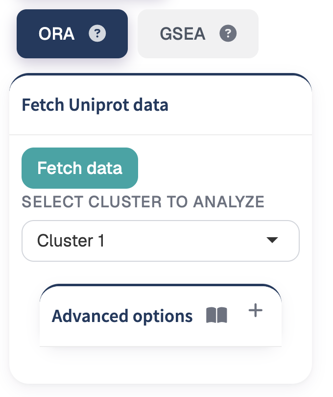
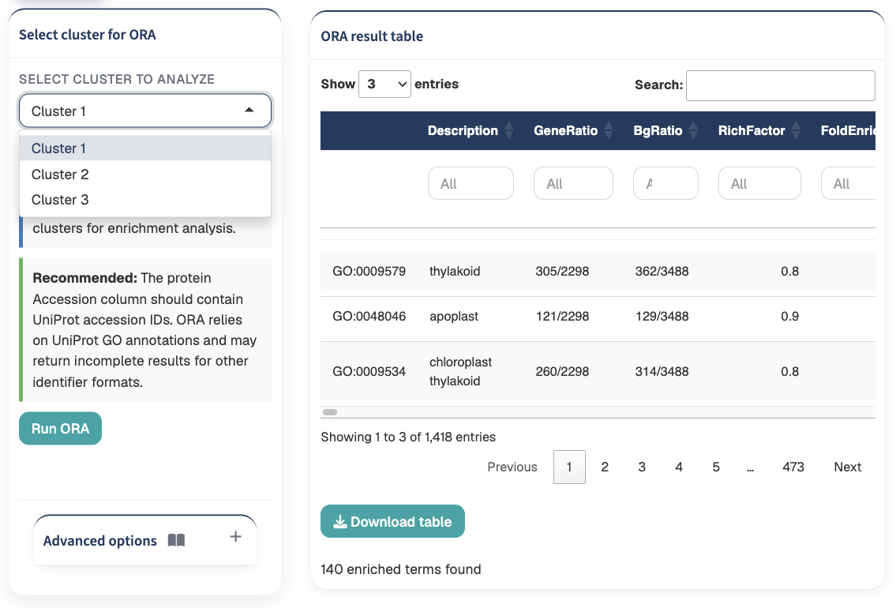
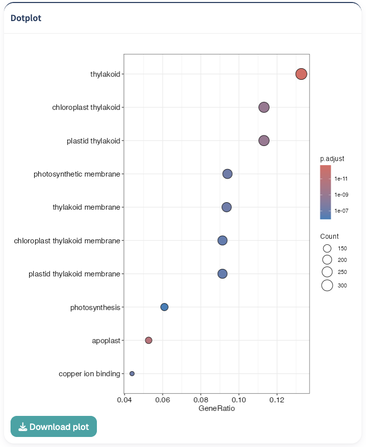
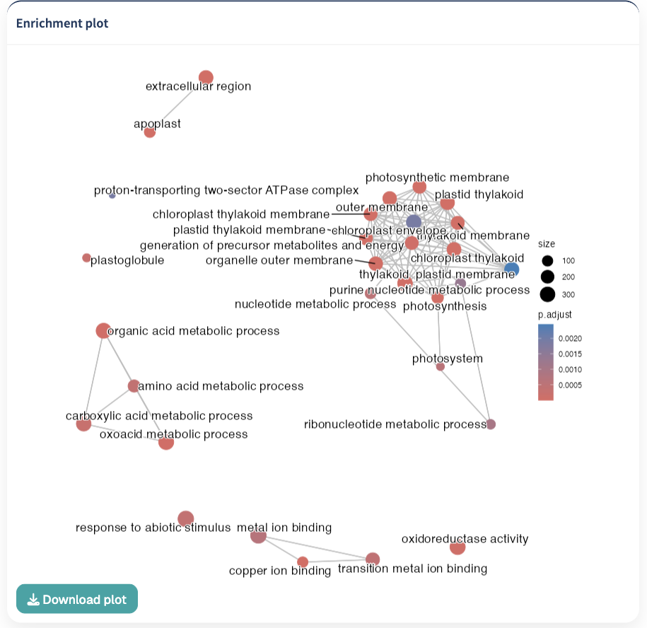
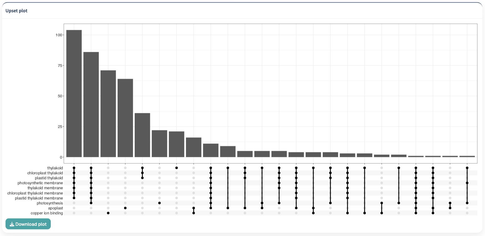
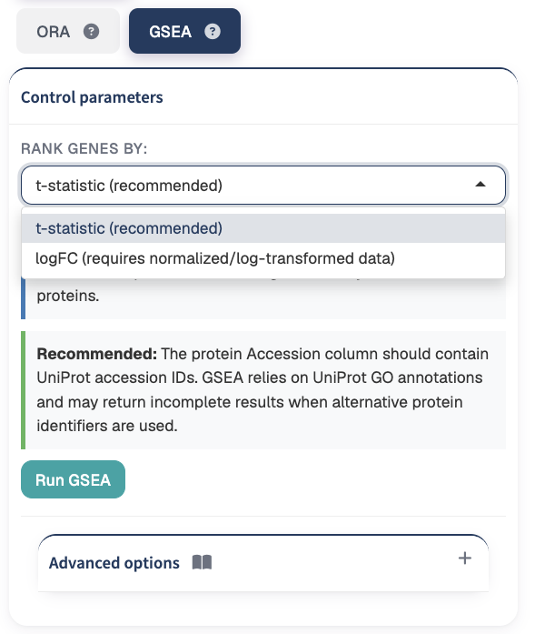
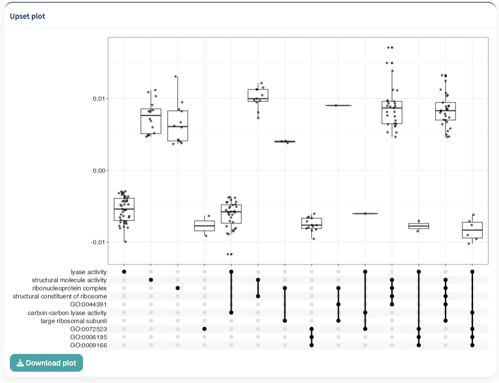
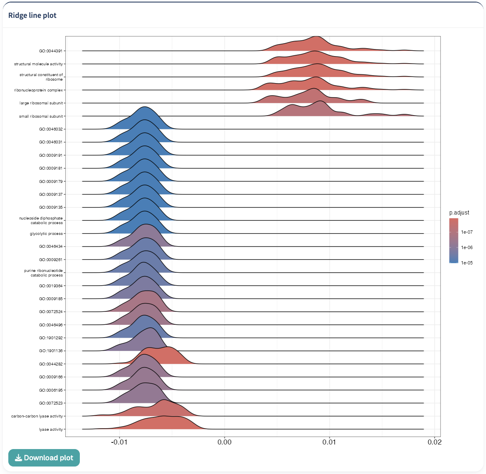
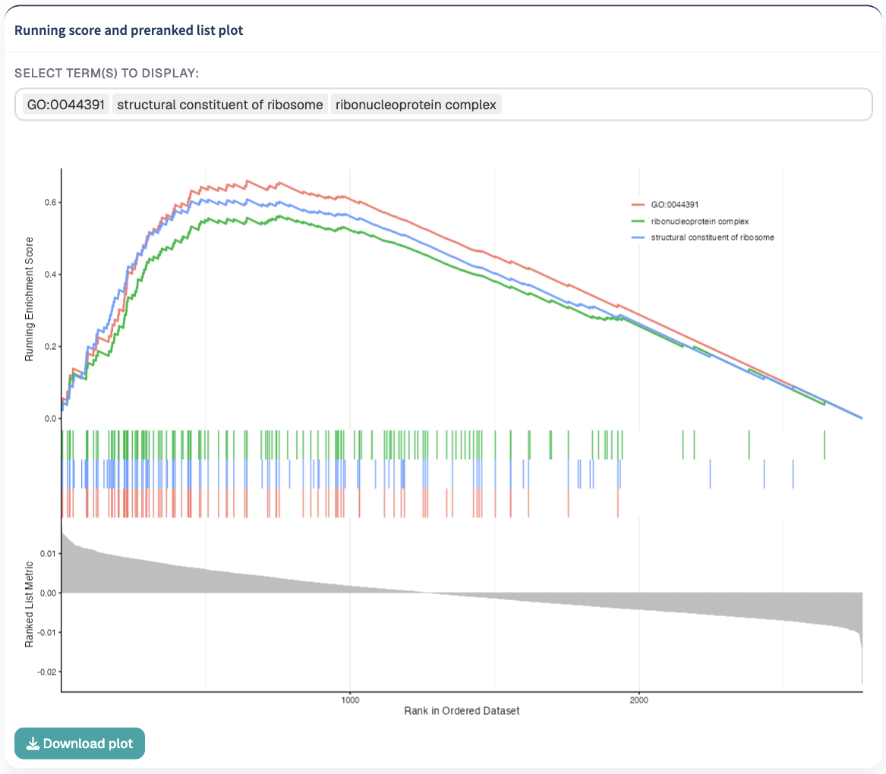

The GO Analysis section provides tools for investigating the biological functions associated with proteins identified during TPP analysis.

TPP Analyst provides two complementary Gene Ontology enrichment approaches:

1. **Over-Representation Analysis (ORA)**
2. **Gene Set Enrichment Analysis (GSEA)**

ORA evaluates whether particular Gene Ontology terms are represented more frequently within protein clusters than expected from the background protein set.

GSEA instead evaluates whether proteins associated with particular GO terms tend to occur toward the top or bottom of a ranked protein list.

The two approaches therefore answer related but different biological questions.

# Gene Ontology annotations

Both ORA and GSEA require associations between protein identifiers and Gene Ontology terms.

TPP Analyst uses organism-specific protein annotations to construct these associations.

The GO annotations include terms belonging to the three major Gene Ontology categories:

- **Biological Process (BP)**
- **Molecular Function (MF)**
- **Cellular Component (CC)**

::: {.callout-tip}
## Protein identifiers

UniProt accession identifiers are recommended in the `Accession` column.

GO analysis relies on matching the protein identifiers in the analyzed dataset to the available GO annotations. Alternative identifier formats may result in incomplete or unsuccessful annotation matching.
:::


## Fetching UniProt annotations

When organism annotation data are not already available, TPP Analyst can retrieve GO information for the proteins in the clustered dataset.

Click:

**Fetch data**

{#fig-experimental-design width=55%}

to retrieve the required protein annotation information.

The protein accessions from the current clustered dataset are used for this process.

::: {.callout-note}
## Annotation retrieval

Fetching GO information is required only when the corresponding organism annotation data are not already available to the application or not provided by the user when loading the datasets.
:::

# Over-Representation Analysis

The **Over-Representation Analysis (ORA)** workflow evaluates whether proteins associated with particular GO terms are represented more frequently within a protein cluster than expected from the background protein population.

In TPP Analyst, ORA is performed independently for the protein clusters generated in the Clustering section.

## Requirement: clustering

ORA requires protein cluster assignments.

Before running ORA, first complete the [Clustering](clustering.qmd) analysis.

The proteins assigned to each cluster are used as the target protein sets for enrichment analysis.

::: {.callout-important}
## Clustering is required

Run the **Clustering** section before performing ORA.

ORA uses the protein clusters generated during clustering as the groups tested for functional enrichment.
:::

## Background protein set

The background for ORA consists of the unique protein accessions available in the clustered dataset.

Each individual cluster is then compared against this background.

This allows enrichment results to be interpreted relative to the proteins available in the analyzed experiment.

## Selecting a cluster

Use:

**Select cluster to analyze**

to choose the cluster whose ORA results should be displayed.

Available choices depend on the number of clusters generated during clustering.

For example:

```text
Cluster 1
Cluster 2
Cluster 3
Cluster 4
```

The enrichment analysis is calculated for the available clusters, while the selector determines which cluster is displayed in the result table and plots.

## Running ORA

After clustering and GO annotations are available, click:

**Run ORA**

to perform enrichment analysis.

{#fig-experimental-design width=85%}

The proteins belonging to each cluster are tested against the GO annotation database using the configured statistical parameters.

Results are then available for individual clusters through the cluster selector.

# ORA advanced options

The **Advanced options** panel provides additional control over the statistical enrichment procedure.

The available settings are:

- **p-value adjustment method**
- **Minimum gene set size**
- **Maximum gene set size**
- **p-value cutoff**
- **q-value cutoff**
- **Expand GO hierarchy**

For most analyses, the default settings provide a convenient starting point.

## Multiple-testing correction

The:

**p-value adjustment method**

determines how p-values are corrected for multiple hypothesis testing.

Available options include:

```text
BH
holm
hochberg
hommel
bonferroni
BY
fdr
none
```

The default method is:

```text
BH
```

::: {.callout-note}
## Multiple GO terms are tested

GO enrichment analysis evaluates many terms simultaneously. Multiple-testing correction helps control the statistical error associated with performing many enrichment tests.
:::

## Minimum gene set size

The:

**Minimum gene set size**

determines the minimum number of annotated proteins required for a GO term to be considered during enrichment analysis.

The default value is:

```text
10
```

GO terms containing fewer proteins than this threshold are excluded.

## Maximum gene set size

The:

**Maximum gene set size**

defines the maximum number of annotated proteins allowed for a GO term.

The default value is:

```text
500
```

Terms exceeding this limit are excluded from the enrichment analysis.

These minimum and maximum thresholds can be used to avoid testing gene sets that are either very small or extremely broad.

## P-value cutoff

The:

**p-value cutoff**

defines the significance threshold used during ORA.

The default value is:

```text
0.05
```

## Q-value cutoff

The:

**q-value cutoff**

provides an additional significance threshold for enrichment results.

The default value is:

```text
0.2
```

## Expand GO hierarchy

The:

**Expand GO hierarchy (buildGOmap)**

option is enabled by default.

When enabled, TPP Analyst expands the protein-to-GO associations through the Gene Ontology hierarchy.

This propagates annotations to related parent GO terms, increasing the coverage of the enrichment database.

::: {.callout-tip}
## GO hierarchy expansion

Enable **Expand GO hierarchy** when enrichment should consider the hierarchical relationships between GO terms.

Because parent GO categories are generally broader than their descendant terms, hierarchy expansion can increase annotation coverage while also producing broader functional enrichment results.

This option will considerably increase the loading time for the enrichment database, especially for organisms with large annotation sets.
:::

# ORA results table

The **ORA result table** displays the enrichment results for the currently selected cluster.

Results are ordered according to adjusted p-value.

The table contains information describing the enriched GO terms together with their statistical enrichment results.

The exact result fields are generated from the enrichment analysis and include GO descriptions and associated statistical measures.

The table provides column-specific filters that can be used to inspect particular terms or result ranges.

A summary below the table reports the number of enriched terms identified for the selected cluster.

## GO ontology categories

TPP Analyst determines whether enriched terms belong to:

- **BP**: Biological Process
- **CC**: Cellular Component
- **MF**: Molecular Function

The GO description associated with each identifier is retrieved from the Gene Ontology annotation resources used by the application.

# ORA visualizations

TPP Analyst provides three complementary visualizations for interpreting ORA results:

1. **Dotplot**
2. **Enrichment map**
3. **Upset plot**

The visualizations are generated for the currently selected cluster.

## ORA dotplot

The **Dotplot** summarizes the enriched GO terms identified for the selected cluster.

{#fig-experimental-design width=85%}

The plot provides a compact overview of significant functional categories and their enrichment characteristics.

Only results containing GO terms with adjusted p-values below:

```text
0.05
```

are displayed.

If no terms satisfy this criterion, TPP Analyst displays:

```text
No enriched terms found
```

## Enrichment map

The **Enrichment plot** displays relationships between enriched GO terms based on their similarity.

{#fig-experimental-design width=85%}

The enrichment map is useful for identifying groups of related functional categories rather than interpreting every enriched GO term independently.

At least three significant GO terms are required to generate the enrichment map.

If fewer than three significant terms are available, TPP Analyst displays:

```text
Enrichment map requires at least 3 significant GO terms.
```

::: {.callout-tip}
## Interpreting related GO terms

GO enrichment frequently produces several related or partially overlapping terms.

The enrichment map can help reveal broader functional themes represented by groups of related GO categories.
:::

## ORA Upset plot

The **Upset plot** visualizes overlap between the protein sets associated with enriched GO terms.

{#fig-experimental-design width=85%}

This can help identify proteins contributing to multiple enriched biological categories.

As with the other ORA visualizations, the plot requires significant enrichment results with adjusted p-values below 0.05.


# Gene Set Enrichment Analysis

Gene Set Enrichment Analysis (GSEA) provides an alternative approach to functional interpretation.

Unlike ORA, GSEA does not begin with proteins separated into a significant target group and background group.

Instead, proteins are ordered according to a quantitative ranking statistic, and the analysis determines whether proteins associated with particular GO terms tend to accumulate toward one end of that ranked list.

::: {.callout-note}
## ORA versus GSEA

**ORA** asks whether GO terms are over-represented within a predefined protein group such as a cluster.

**GSEA** asks whether proteins associated with a GO term tend to occur preferentially toward the top or bottom of a ranked list.

These approaches provide complementary views of functional enrichment.
:::

# Requirement: Limma analysis

GSEA uses the statistical results generated in the Limma section of Model Fitting.

Before running GSEA, complete the Limma analysis in [Model Fitting](modelfitting.qmd).

::: {.callout-important}
## Limma is required

Run **Limma** before performing GSEA.

The Limma results provide the statistics used to rank proteins for the enrichment analysis.
:::

## Ranking proteins

TPP Analyst provides two ranking metrics:

- **t-statistic**
- **logFC**

The ranking statistic determines the order of proteins provided to GSEA.

{#fig-experimental-design width=60%}

## t-statistic

The:

**t-statistic**

option ranks proteins according to the t-statistic obtained from the Limma analysis.

This is the recommended ranking method in the interface.

Because the t-statistic incorporates both effect magnitude and its estimated variability, it provides a statistical ranking of the temperature-associated protein responses.

## logFC

The:

**logFC**

option ranks proteins according to the estimated effect generated by the Limma analysis.

This option is intended for appropriately normalized or transformed data.

::: {.callout-warning}
## logFC and raw intensity data

When logFC values appear to remain on a raw-intensity scale, TPP Analyst displays a warning recommending either:

- t-statistic ranking; or
- normalization/log transformation before using logFC.

For this reason, **t-statistic** is the recommended default ranking method.
:::

## Running GSEA

After selecting the ranking statistic, click:

**Run GSEA**

TPP Analyst:

1. obtains the protein ranking from the Limma results;
2. constructs the protein-to-GO mappings;
3. optionally expands the GO hierarchy;
4. performs the enrichment analysis using the ranked protein list.

Proteins with missing ranking values are excluded from the ranked list.

# GSEA advanced options

The GSEA **Advanced options** panel provides controls for:

- **p-value adjustment method**
- **Minimum gene set size**
- **Maximum gene set size**
- **p-value cutoff**
- **Exponent**
- **Number of permutations**
- **Expand GO hierarchy**

## GSEA p-value adjustment method

Available multiple-testing correction methods include:

```text
BH
holm
hochberg
hommel
bonferroni
BY
fdr
none
```

The default method is:

```text
BH
```

## Minimum gene set size

The default minimum gene set size is:

```text
5
```

GO sets containing fewer mapped proteins are excluded from the analysis.

## Maximum gene set size

The default maximum gene set size is:

```text
500
```

GO sets larger than this threshold are excluded.

## GSEA p-value cutoff

The default p-value cutoff is:

```text
0.05
```

## Exponent

The **Exponent** controls the weighting applied to the ranked protein list during enrichment score calculation.

The default value is:

```text
1
```

The interface allows values from 0 to 5.

## Number of permutations

The number of permutations controls the permutation-based estimation performed during GSEA.

The default value is:

```text
10,000
```

The application allows values from:

```text
10,000 to 500,000
```

in increments of:

```text
10,000
```

::: {.callout-warning}
## Number of permutations

Increasing the number of permutations can increase computation time considerably.

Use larger values when additional statistical stability is required and the additional computational cost is acceptable.
:::

## GSEA GO hierarchy expansion

The:

**Expand GO hierarchy (buildGOmap)**

option determines whether protein annotations are propagated through the GO hierarchy before GSEA.

The option is enabled by default.

As in ORA, hierarchy expansion can increase annotation coverage while also introducing broader parent GO categories into the analysis.

# GSEA results and visualizations

TPP Analyst provides three main visualizations for GSEA:

1. **Upset plot**
2. **Ridge line plot**
3. **Running score and preranked list plot**

Visualizations are displayed when significant enrichment results are available.

## GSEA Upset plot

The **Upset plot** summarizes overlap among proteins associated with enriched GO terms.

{#fig-experimental-design width=85%}

This helps identify proteins contributing to several functionally enriched categories.

If no terms have an adjusted p-value below 0.05, the application reports:

```text
No enriched terms found
```

## Ridge line plot

The **Ridge line plot** displays the distribution of ranked protein values associated with enriched GO terms.

{#fig-experimental-design width=85%}

The plot provides a comparative overview of where proteins belonging to different functional categories occur within the ranked protein list.

This can help distinguish GO terms whose associated proteins show different distributions across the ranking statistic.

## Running score and preranked list plot

The **Running score and preranked list plot** provides a detailed visualization of individual GSEA results.

{#fig-experimental-design width=85%}

After GSEA has been performed, significant GO terms become available in:

**Select term(s) to display**

The selector can be searched using the GO term description.

Multiple significant terms can be selected simultaneously.

The resulting plot displays the enrichment running score across the ranked protein list for the selected GO sets.

::: {.callout-tip}
## Examining individual GO terms

Use the running-score plot when a particular biological process, molecular function, or cellular component is of special interest.

The searchable term selector makes it possible to move from the global enrichment overview to individual GO terms.
:::

## Significant terms available for plotting

The term selector contains GO terms with adjusted p-values below:

```text
0.05
```

GO descriptions are displayed in the selector when available, while the corresponding GO identifiers are used internally for plotting.

This allows enriched terms to be located using their biological descriptions rather than GO identifiers alone.


# Recommended ORA workflow

A typical ORA workflow is:

1. **Complete the Clustering analysis.**
2. **Ensure protein identifiers can be matched to GO annotations.**
3. **Fetch annotation data when organism annotations are not already available.**
4. **Review the advanced options or retain the default settings.**
5. **Decide whether GO hierarchy expansion should be used.**
6. **Click Run ORA.**
7. **Select the cluster of interest.**
8. **Inspect the enrichment result table.**
9. **Review significant GO terms in the dotplot.**
10. **Use the enrichment map to identify groups of related terms.**
11. **Use the Upset plot to inspect overlapping protein sets.**
12. **Repeat the interpretation for additional clusters.**
13. **Download relevant tables and figures.**

# Recommended GSEA workflow

A typical GSEA workflow is:

1. **Run the Limma analysis in the Model Fitting section.**
2. **Ensure protein identifiers can be matched to GO annotations.**
3. **Select the desired ranking statistic.**
4. **Use t-statistic ranking as the recommended starting option.**
5. **Review the advanced GSEA parameters.**
6. **Decide whether GO hierarchy expansion should be enabled.**
7. **Select the desired number of permutations.**
8. **Click Run GSEA.**
9. **Inspect the Upset plot for overlap among enriched terms.**
10. **Inspect the ridge line plot for global ranking patterns.**
11. **Search for specific significant GO terms using the term selector.**
12. **Inspect their running enrichment score profiles.**
13. **Download the relevant enrichment visualizations.**

# Choosing between ORA and GSEA

ORA and GSEA can be used independently or as complementary analyses.

A practical distinction is:

```text
ORA
↓
Starts from protein groups
↓
Tests whether particular GO terms are over-represented
```

while:

```text
GSEA
↓
Starts from a ranked protein list
↓
Tests whether GO-associated proteins accumulate toward the extremes of that ranking
```

In TPP Analyst, this also determines which upstream analysis is required:

```text
Clustering
    ↓
   ORA
```

and:

```text
Limma
   ↓
  GSEA
```

::: {.callout-important}
## Functional enrichment depends on annotation quality

GO analysis can only evaluate proteins that can be associated with the available GO annotations.

Using consistent UniProt accession identifiers improves the ability of TPP Analyst to match the analyzed proteins to organism-specific functional annotations.
:::

## Next step

After functional enrichment analysis, continue to [Comparison Models](modelcomparison.qmd) to statistically compare thermal stability profiles between experimental conditions.