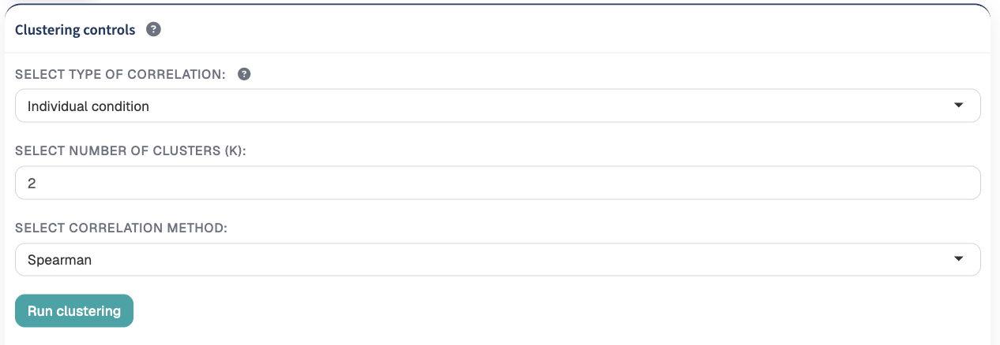
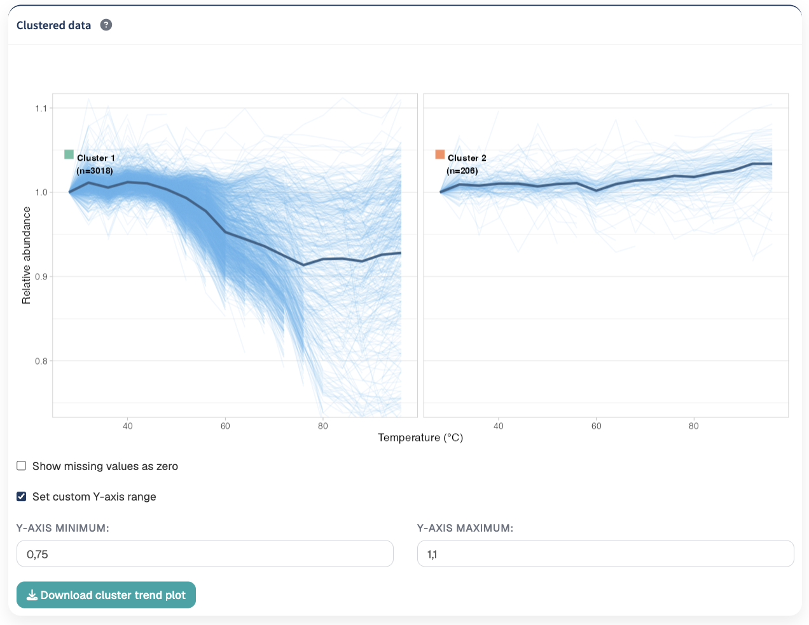
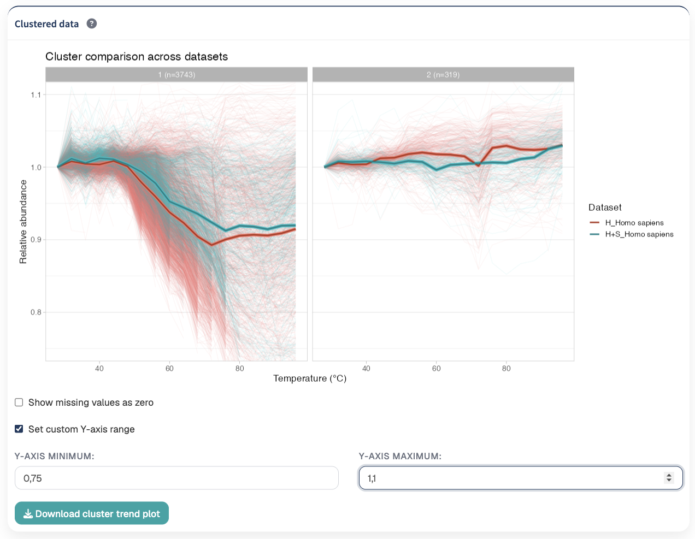
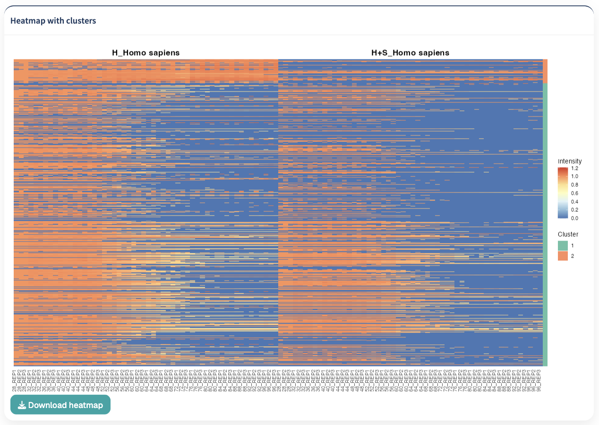

The Clustering module groups proteins according to similarities in their thermal abundance profiles across the temperature gradient.

Clustering can be performed on an individual experimental condition or across multiple conditions. TPP Analyst also provides silhouette-based guidance for selecting the number of clusters and allows individual clusters to be further divided using sub-clustering.


The main steps of the clustering workflow are:

1. **Select the clustering mode**
2. **Select the correlation method**
3. **Specify the number of clusters**
4. **Run clustering**
5. **Inspect the silhouette-based cluster recommendation**
6. **Examine the cluster thermal profiles**
7. **Inspect the cluster heatmap**
8. **Sub-cluster individual clusters when additional resolution is required**

## Clustering controls

{#fig-clustering-controls width=85%}

Clustering is based on similarities between protein thermal profiles.

TPP Analyst calculates the correlation between protein profiles and uses the resulting correlation-based dissimilarities to perform hierarchical clustering.

Two clustering modes are available:

- **Individual condition**
- **Condition comparison**

## Individual condition

The **Individual condition** mode performs clustering using the thermal profiles from the current dataset.

Each protein is represented by its measurements across temperatures and replicates.

Proteins displaying similar thermal abundance patterns are grouped into the same cluster.

This mode is useful for exploring the major thermal-profile patterns present within a single experimental condition.

## Condition comparison

The **Condition comparison** mode allows protein profiles from multiple datasets to be considered simultaneously.

Select the datasets to include using:

**Select datasets for comparison**

The measurements belonging to the same protein across the selected datasets are combined into a single profile before the correlation between proteins is calculated.

This allows proteins to be clustered according to their collective behavior across multiple experimental conditions.

::: {.callout-tip}
## Individual versus comparison clustering

Use **Individual condition** to identify groups of proteins with similar thermal profiles within one dataset.

Use **Condition comparison** when you want clustering to consider how proteins behave across several experimental conditions simultaneously.
:::

### Combining proteins across datasets

In comparison mode, datasets are matched using the protein accession.

The quantitative measurements from the selected datasets are then combined before clustering.

This allows the clustering result to reflect protein behavior across all included datasets rather than evaluating the datasets independently.

::: {.callout-note}
## Protein identifiers

Comparison clustering relies on the protein accession to associate protein measurements between datasets. Consistent protein identifiers are therefore important when comparing conditions.
:::

## Correlation method

TPP Analyst provides two correlation methods:

- **Pearson**
- **Spearman**

The selected correlation method determines how similarity between protein thermal profiles is calculated.

### Pearson correlation

**Pearson correlation** measures the linear relationship between two protein profiles.

Proteins with similar quantitative patterns across the thermal gradient will have stronger positive correlations.

### Spearman correlation

**Spearman correlation** compares the ranked values of the protein profiles.

Because it is based on ranks, Spearman correlation focuses more strongly on the overall ordering and shape of the abundance profiles rather than requiring a linear relationship between their absolute values.

Spearman correlation is selected by default in TPP Analyst.

::: {.callout-tip}
## Choosing a correlation method

Use **Pearson** when similarity in the quantitative shape and magnitude of the profiles is important.

Use **Spearman** when the relative pattern across temperatures is more important and you want the clustering to be less dependent on the exact quantitative relationship between profiles.
:::

## Number of clusters

The **Select number of clusters (k)** control specifies how many groups will be generated.

TPP Analyst allows values between:

```text
2 and 10
```

The default value is:

```text
k = 4
```

After selecting the desired number of clusters and correlation method, click:

**Run clustering**

The selected number of clusters is used to divide the hierarchical clustering tree into the requested groups.

::: {.callout-note}
## Choosing k

The manually selected value of `k` determines the clustering result.

TPP Analyst also calculates a silhouette-based recommendation after clustering has been run to help evaluate whether another value of `k` may provide better separation.
:::

## Cluster recommendation

After clustering has been performed, TPP Analyst evaluates alternative numbers of clusters using **silhouette analysis**.

{#fig-silhouette-analysis width=85%}

The silhouette score measures how well each protein matches its assigned cluster relative to neighboring clusters.

Higher average silhouette scores indicate stronger separation between the resulting clusters.

TPP Analyst evaluates candidate values of `k` from 2 up to a maximum of 10, depending on the number of proteins available in the dataset.

The application reports:

- the **recommended number of clusters**;
- the corresponding **average silhouette score**.

## Cluster quality assessment plot

The cluster quality assessment plot displays the average silhouette score as a function of the number of clusters.

The X-axis represents:

```text
Number of clusters (k)
```

and the Y-axis represents:

```text
Average silhouette score
```

The recommended value of `k` is indicated by a red dashed line.

::: {.callout-important}
## Recommendation versus selected k

The silhouette result is a recommendation and does not automatically replace the value of `k` selected by the user.

If the recommended value differs from the current clustering solution, change the number of clusters and click **Run clustering** again to generate the corresponding result.
:::

::: {.callout-tip}
## Using the silhouette recommendation

The highest silhouette score provides a useful statistical criterion for selecting `k`, but clustering should also be evaluated biologically.

Inspect the resulting thermal-profile trends, cluster sizes, and heatmap before deciding which clustering solution is most informative for the experiment.
:::

## Clustered data

After clustering has been performed, TPP Analyst generates a thermal-profile visualization for each cluster.

Each cluster is displayed in a separate panel.

{#fig-clustered-data width=85%}

The visualization includes:

- individual protein thermal profiles;
- the average thermal profile of the cluster;
- the cluster identifier;
- the number of proteins assigned to the cluster.

## Individual protein trends

Individual protein profiles are displayed as thin lines.

For each protein, replicate measurements are summarized at each temperature to generate its thermal abundance profile.

These individual profiles provide an overview of the variability among proteins assigned to the same cluster.

## Average cluster trend

A stronger line represents the average thermal profile of all proteins assigned to the corresponding cluster.

The average trend provides a concise representation of the dominant thermal behavior of each group.

The number of proteins assigned to each cluster is displayed as:

```text
n = number of proteins
```

This allows both the shape and size of each cluster to be assessed.

## Missing and zero values in trend plots

The cluster visualization provides the option:

**Show missing values as zero**

When this option is disabled, zero-valued measurements are omitted from the calculation of the displayed thermal trends.

When the option is enabled, zero measurements are retained in the visualization.

::: {.callout-important}
## Visualization versus clustering

The **Show missing values as zero** setting controls how zero values are represented in the cluster trend visualization.

Changing this checkbox does not rerun the clustering or alter the existing cluster assignments.
:::

## Custom Y-axis range

Enable:

**Set custom Y-axis range**

to manually control the displayed Y-axis of the cluster trend plots.

Two values can then be specified:

- **Y-axis minimum**
- **Y-axis maximum**

This can be useful when a small number of proteins have unusually large abundance values that expand the plot range and make the dominant cluster trends difficult to inspect.

::: {.callout-tip}
## Adjusting the Y-axis

Changing the Y-axis range affects only the displayed portion of the cluster trend plot.

It does not remove proteins, modify their abundance values, or recalculate the clustering result.
:::

## Condition comparison visualization

When clustering is performed using **Condition comparison**, each cluster shows the profiles of the datasets included in the comparison.

{#fig-clustered-data width=85%}

Individual protein profiles are displayed together with stronger average profiles representing the general thermal trend for each dataset.

The dataset-specific trends are distinguished using color.

This visualization can be used to investigate whether proteins assigned to the same cluster show similar or contrasting behavior between experimental conditions.

## Cluster heatmap

TPP Analyst generates a heatmap containing the proteins used in the clustering analysis.

{#fig-clustered-data width=85%}

Each row represents a protein and each column represents a quantitative measurement.

Protein abundance is represented by the heatmap color scale.

Proteins are organized according to their assigned cluster and the hierarchical clustering structure.

A cluster annotation identifies the cluster associated with each protein.

::: {.callout-note}
## Consistent cluster colors

Cluster colors are shared between the cluster trend visualization and the cluster heatmap.

The same color therefore identifies the same cluster across the two visualizations.
:::

### Heatmap organization

Measurement columns are arranged according to:

1. dataset;
2. temperature;
3. replicate.

In comparison mode, dataset names are displayed above their corresponding groups of measurements.

This organization makes it easier to compare thermal patterns between temperatures, replicates, and experimental datasets.

## Sub-clustering

TPP Analyst allows an existing cluster to be subjected to a second clustering analysis.

This functionality can be useful when a broad cluster contains several more specific thermal response patterns that are not resolved in the initial clustering result.

Expand the:

**Sub-cluster data**

section to access the sub-clustering controls.

## Selecting a cluster to sub-cluster

Use:

**Select cluster to sub-cluster (1 to k)**

to specify which cluster from the original clustering result should be analyzed further.

Only the proteins assigned to the selected cluster are included in the sub-clustering analysis.

## Number of sub-clusters

Use:

**Select number of clusters for sub-clustering**

to specify how many new groups should be generated within the selected original cluster.

The available range is:

```text
2 to 10
```

The selected original cluster must contain enough proteins to support the requested number of sub-clusters.

Click:

**Run Sub-clustering**

to generate the new clustering solution.

## Sub-cluster recommendation

TPP Analyst also performs silhouette analysis within the selected original cluster.

The procedure evaluates alternative values for the number of sub-clusters and identifies the value associated with the highest average silhouette score.

For the recommendation to be calculated, the selected original cluster must contain at least five proteins.

The application reports:

- the recommended number of sub-clusters;
- the corresponding average silhouette score.

A sub-cluster quality assessment plot displays the silhouette scores across the candidate values of `k`.

::: {.callout-note}
## Sub-cluster recommendation

Sub-cluster silhouette analysis is performed only on the proteins belonging to the selected original cluster.

The recommendation may therefore differ substantially from the optimal number of clusters for the complete dataset.
:::

## Sub-clustered trend plot

After sub-clustering, TPP Analyst generates a separate thermal-profile panel for each resulting sub-cluster.

As in the main clustering visualization, the plot contains:

- individual protein thermal profiles;
- an average sub-cluster thermal profile;
- the sub-cluster identifier;
- the number of proteins assigned to each sub-cluster.

When the original clustering was performed in comparison mode, the sub-cluster visualization retains the dataset-specific thermal profiles.

This allows smaller condition-dependent patterns to be investigated within a broader original cluster.

## Missing and zero values in sub-cluster plots

The sub-cluster visualization has its own independent control:

**Show missing values as zero (sub-clustering plot)**

When disabled, zero-valued measurements are omitted from the displayed trends.

When enabled, zero measurements are retained in the visualization.

This control affects the sub-cluster trend display independently of the corresponding setting in the main clustering plot.

## Custom Y-axis range for sub-clusters

The sub-cluster visualization also provides:

**Set custom Y-axis range**

When enabled, specify:

- **Y-axis minimum**
- **Y-axis maximum**

This allows the displayed abundance range to be adjusted independently for the sub-cluster visualization.

::: {.callout-note}
## Independent visualization settings

The main clustering and sub-clustering trend plots have separate controls for zero-value display and Y-axis limits.

Changing the settings of one visualization does not modify the corresponding settings of the other.
:::

## Sub-cluster heatmap

TPP Analyst generates a heatmap containing only proteins belonging to the selected original cluster.

Proteins are ordered according to their new sub-cluster assignments and hierarchical clustering structure.

A colored annotation identifies the sub-cluster assigned to each protein.

For comparison analyses, samples remain organized by dataset, temperature, and replicate.

::: {.callout-note}
## Consistent sub-cluster colors

Sub-cluster colors are shared between the sub-cluster trend plot and the sub-cluster heatmap.

A given color therefore represents the same sub-cluster across both visualizations.
:::


## Recommended clustering workflow

A typical clustering analysis in TPP Analyst is:

1. **Decide whether the analysis should use an individual condition or compare multiple conditions.**
2. **Select the datasets when using condition comparison.**
3. **Select Pearson or Spearman correlation.**
4. **Choose an initial number of clusters.**
5. **Click Run clustering.**
6. **Inspect the silhouette recommendation and cluster quality plot.**
7. **If appropriate, change k and rerun the clustering.**
8. **Inspect the individual protein profiles and average trend within each cluster.**
9. **Check the number of proteins assigned to each cluster.**
10. **Adjust the zero-value display if needed.**
11. **Adjust the Y-axis range if extreme values obscure the main trends.**
12. **Inspect the cluster heatmap.**
13. **Identify clusters containing potentially distinct internal thermal patterns.**
14. **Select an original cluster for sub-clustering when additional resolution is required.**
15. **Inspect the sub-cluster silhouette recommendation.**
16. **Select the desired number of sub-clusters and run the analysis.**
17. **Inspect the sub-cluster trends and heatmap.**
18. **Export the relevant visualizations.**

::: {.callout-important}
## Interpret clusters as patterns

Clustering is an exploratory analysis. Cluster assignments identify groups of proteins with similar quantitative thermal profiles under the selected clustering settings.

The resulting groups should be interpreted together with the experimental design, cluster sizes, thermal trends, and downstream biological analyses.
:::

## Next step

After identifying and examining the major thermal-profile patterns in the dataset, continue to [Model Fitting](modelfitting.qmd).