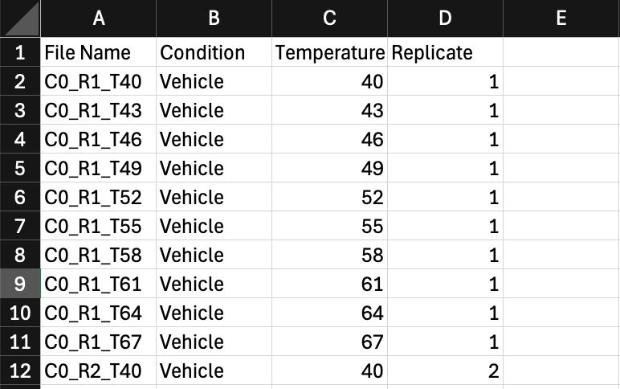
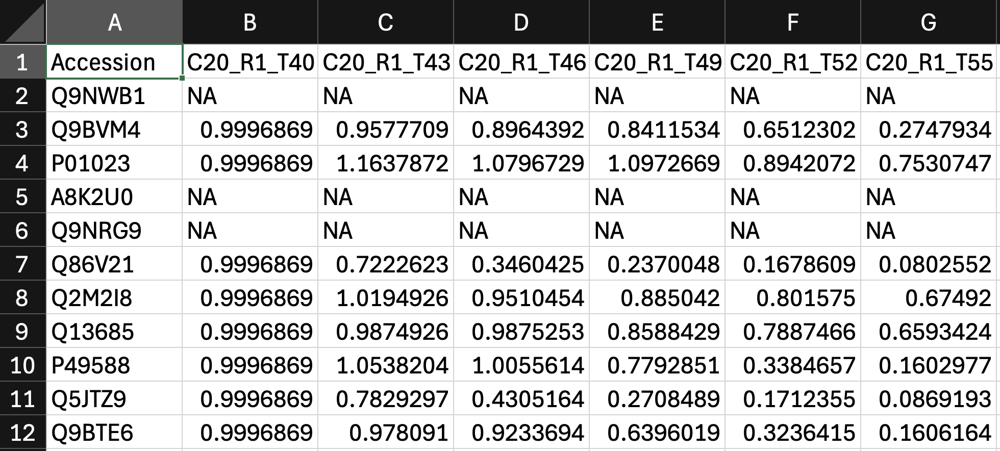
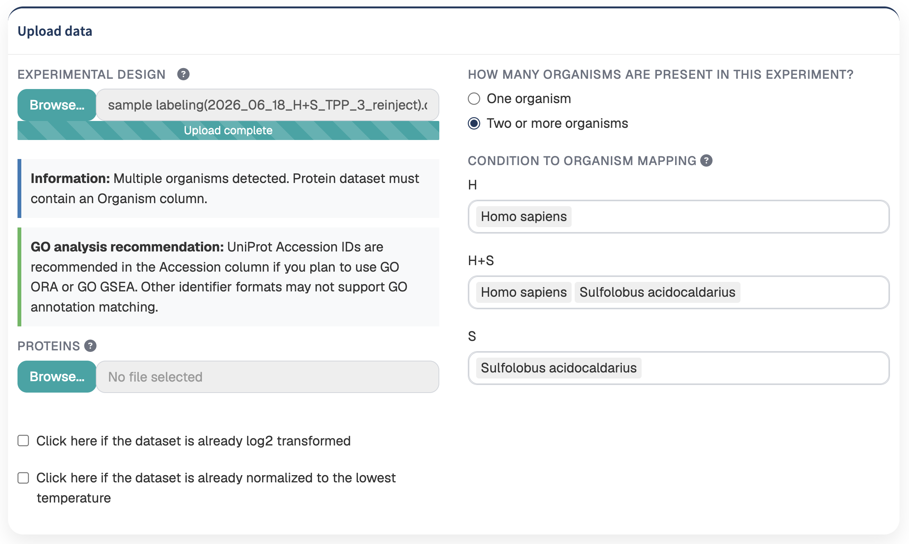
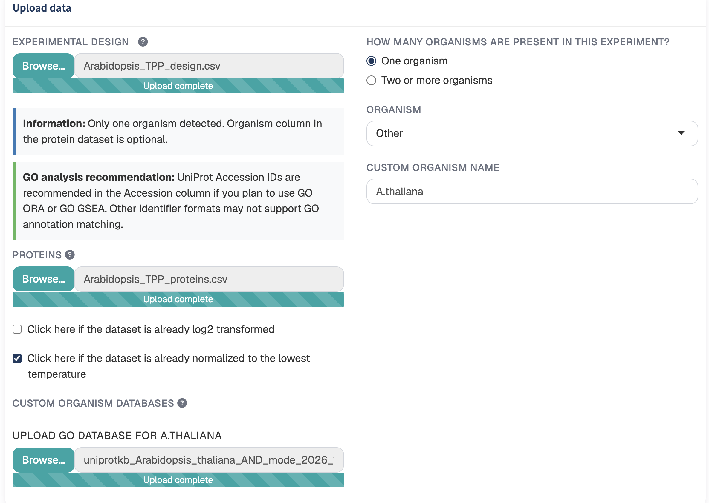
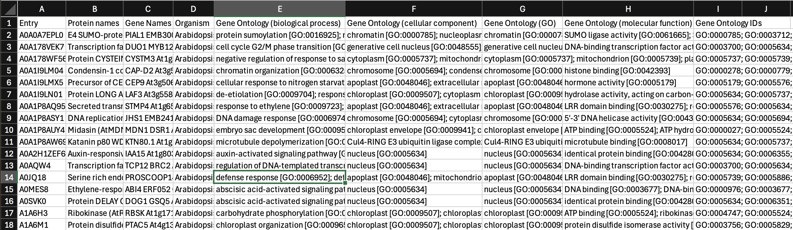
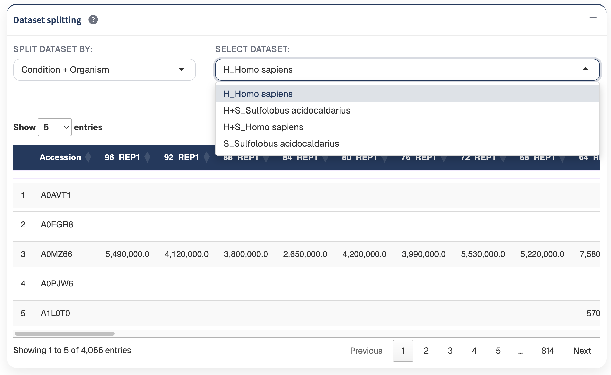

TPP Analyst requires quantitative protein abundance data together with an experimental design describing the structure of the experiment.

TPP Analyst supports the following file formats:

- CSV (`.csv`)
- TSV (`.tsv`)
- text (`.txt`)
- Excel (`.xlsx`) or (`.xls`)


## Experimental design

The experimental design describes how the quantitative measurements are associated with the experiment.

The required columns are:

- `File Name`
- `Condition`
- `Temperature`
- `Replicate`

{#fig-experimental-design width=85%}

### File Name

The `File Name` column identifies the quantitative measurement corresponding to the protein abundance dataset.


### Condition

The `Condition` column identifies the experimental condition associated with each measurement.

Examples include:

- Control
- Vehicle
- Treatment

### Temperature

The `Temperature` column contains the experimental temperature associated with each measurement.

Temperature values must be numeric.

### Replicate

The `Replicate` column identifies the replicate associated with each measurement.

Each combination of condition, temperature, and replicate should correspond to the appropriate quantitative measurement in the protein abundance dataset.

## Protein abundance dataset

The protein abundance dataset contains the protein identifiers and quantitative measurements.

The required identifier column is:

`Accession`

Each row represents a protein, while the remaining quantitative columns contain the protein abundance measurements associated with the experiment linked to the values of the Experimental Design column: `File Name`.

{#fig-protein-dataset width=95%}

### Protein identifiers

Each value in the `Accession` column must be unique.

::: {.callout-tip}
## Recommendation

UniProt accession identifiers are recommended, particularly when GO analysis will be performed.
:::

::: {.callout-warning}
## Duplicate identifiers

The `Accession` column must contain unique identifiers. Duplicated protein identifiers must be resolved before the dataset can be processed.
:::

### Organism column

For experiments containing multiple organisms, the protein abundance dataset must additionally contain an `Organism` column.

For single-organism experiments, this column is optional.

All remaining columns should contain the quantitative protein abundance measurements corresponding to the samples described in the experimental design.


## Organism selection

TPP Analyst supports both single-organism and multi-organism experiments.


### Single-organism experiments

When a single organism is selected, the `Organism` column in the protein abundance dataset is optional.

The selected organism is associated with the processed datasets automatically.

### Multi-organism experiments

When multiple organisms are selected, the protein abundance dataset must contain an additional column named:

`Organism`

Each protein must be associated with its corresponding organism.

::: {.callout-important}
## Multi-organism datasets

The `Organism` column is required when more than one organism is present in the experiment.
:::

TPP Analyst can recognize supported organism names when they occur within longer organism descriptions.

For example:

```text
Sulfolobus acidocaldarius DSM 639
```

can be recognized as:

```text
Sulfolobus acidocaldarius
```

This allows organism entries containing additional information, such as strain information, to be associated with the corresponding supported organism.

## Condition-to-organism mapping

For multi-organism experiments, TPP Analyst requires the organisms present in each experimental condition to be specified.

Assign the appropriate organism or organisms to each experimental condition before loading the protein abundance dataset.

{#fig-organism-mapping width=90%}


The condition-to-organism mapping is subsequently used when the processed datasets are separated according to condition and organism.

## Other organisms

If the organism being analyzed is not included among the predefined organisms, select **Other**.

The **Other** option allows custom organisms to be incorporated into the analysis workflow.

Additional organism-specific information can subsequently be provided when required for organism-dependent analyses such as Gene Ontology analysis.

{#fig-organism-mapping width=90%}

::: {.callout-note}
## Custom organisms

Use the **Other** option when the organism is not available among the predefined selections. Ensure that the organism information in the protein dataset correctly identifies the proteins belonging to the custom organism.
:::

## Custom organism GO database

TPP Analyst includes built-in annotation databases for the predefined organisms available in the organism selector.

When an organism is not included in the predefined list, select:

**Other**

and provide a name for the custom organism.

A custom organism annotation file can then be uploaded to provide the protein and Gene Ontology information required for downstream functional enrichment analysis.

::: {.callout-note}
## When is a custom GO database needed?

The custom organism database is not required for the general processing, quality control, normalization, clustering, model fitting, or comparison of TPP datasets.

However, a compatible annotation database should be provided when GO enrichment analysis will be performed for an organism selected as **Other**.
:::

### Obtaining a custom organism database

Custom organism annotation files can be downloaded from **UniProt** for the organism of interest.

{#fig-organism-mapping width=90%}

The downloaded file should contain protein identifiers together with protein, gene, organism, and Gene Ontology annotations.

TPP Analyst supports custom organism databases in the following formats:

- CSV (`.csv`)
- TSV (`.tsv`)
- text (`.txt`)
- Excel (`.xlsx`)
- Excel (`.xls`)

### Required columns

The custom organism database must contain the following columns:

```text
Entry
Protein names
Gene Names
Organism
Gene Ontology (GO)
Gene Ontology (biological process)
Gene Ontology (cellular component)
Gene Ontology (molecular function)
Gene Ontology IDs
```

::: {.callout-important}
## Keep the UniProt column names unchanged

The required column names should be retained exactly as provided by UniProt.

If required columns are missing, TPP Analyst will report the custom organism database as invalid and identify the missing columns.
:::

### Protein identifiers

The `Entry` column contains the protein identifiers used to associate the custom annotation database with proteins in the experimental dataset.

For the most reliable matching, the identifiers in the `Accession` column of the protein abundance dataset should correspond to the UniProt identifiers provided in the `Entry` column of the custom organism database.

::: {.callout-tip}
## Recommendation

When using a custom organism database, use UniProt accession identifiers in the protein abundance dataset whenever possible.

Consistent identifiers between the protein dataset and the custom annotation database improve the matching of proteins to GO annotations.
:::

### GO annotation columns

The custom database provides several complementary Gene Ontology annotation fields.

The following columns provide annotations for the three major GO categories:

```text
Gene Ontology (biological process)
Gene Ontology (cellular component)
Gene Ontology (molecular function)
```

These correspond to:

- **Biological Process (BP)**
- **Cellular Component (CC)**
- **Molecular Function (MF)**

The:

```text
Gene Ontology IDs
```

column provides the corresponding GO identifiers.

These annotations are subsequently used by TPP Analyst to construct the protein-to-GO mappings required for ORA and GSEA.

### Custom organism name

For a single-organism experiment, selecting **Other** displays a field where the custom organism name can be entered.

For example:

```text
My custom organism
```

The custom database uploaded for the experiment is associated with this organism name.

For multi-organism experiments, custom organism names are specified separately for the experimental conditions in which **Other** was selected.

### Custom databases in multi-organism experiments

A custom organism can also be combined with predefined organisms in a multi-organism experiment.

For example, a condition could contain:

```text
Homo sapiens
Other
```

The predefined human annotation database is used for `Homo sapiens`, while the uploaded custom annotation database provides the annotation information for the organism represented by **Other**.

When **Other** is assigned to a condition, enter the corresponding custom organism name and upload its organism database.

::: {.callout-tip}
## Mixed-proteome experiments

The custom organism functionality allows TPP Analyst to analyze mixed-proteome experiments containing both predefined and user-provided organisms.

The `Organism` column in the protein abundance dataset should clearly identify which proteins belong to each organism.
:::

### Organism names in the uploaded database

After a custom organism database is loaded, TPP Analyst associates the uploaded annotations with the custom organism name provided in the interface.

This allows the custom organism name used throughout the analysis to remain consistent even when the original UniProt organism annotation contains additional naming information.

### Validation

TPP Analyst validates the structure of the custom organism database when it is uploaded.

If required columns are missing, an error message identifies the missing fields and the annotation database cannot be used until the required structure is provided.

::: {.callout-warning}
## Custom database validation

Before continuing, ensure that the custom annotation file contains all required UniProt annotation columns.

An incomplete database may prevent GO annotation matching and downstream enrichment analysis.
:::

### Relationship between the three input files

When a custom organism is used, the input workflow can therefore contain three types of files:

```text
Experimental design
        +
Protein abundance dataset
        +
Custom organism GO database
```

Their roles are different:

- The **experimental design** describes conditions, temperatures, and replicates.
- The **protein abundance dataset** provides the quantitative protein measurements.
- The **custom organism GO database** provides organism-specific protein and functional annotations for downstream GO analysis.

The custom GO database does not replace either of the two primary experimental input files.


## Example datasets

TPP Analyst includes  the  Staurosporine thermal proteome profiling dataset from the landmark study by Savitski et al. (Science, 2014) - DOI: 10.1126/science.1255784 as example datasets that can be loaded directly from the application.

The example dataset allow the analysis workflow to be explored without uploading custom files and provide examples of data structures compatible with TPP Analyst.


## Dataset splitting

After the input files have been validated, TPP Analyst organizes the protein abundance measurements according to the experimental design.

The available splitting options depend on the number of organisms represented in the experiment.

### Condition only

The **Condition only** option generates one analysis dataset for each experimental condition.

For example:

```text
Vehicle
Treatment
```

All proteins associated with an experimental condition remain within the same dataset.

### Condition + Organism

For multi-organism experiments, the **Condition + Organism** option additionally separates proteins according to organism.

For example:

```text
Human_Homo sapiens
Mixed_Homo sapiens
Mixed_Sulfolobus acidocaldarius
Sulfolobus_Sulfolobus acidocaldarius
```

This allows proteins belonging to different organisms within the same experimental condition to be analyzed independently.

{#fig-dataset-splitting width=95%}

::: {.callout-tip}
## Choosing a splitting strategy

Use **Condition only** when all proteins within an experimental condition should remain together.

Use **Condition + Organism** when proteins from different organisms within the same experimental condition should be analyzed independently.
:::

## Processed dataset preview

Once the protein abundance dataset and experimental design have been processed, the generated datasets can be inspected directly in TPP Analyst.

Before proceeding to downstream analysis, verify that:

- protein accessions were loaded correctly;
- quantitative measurements were correctly associated with the experimental design;
- experimental conditions were correctly separated;
- temperatures were assigned correctly;
- replicates were assigned correctly;
- organism assignments are correct for multi-organism experiments; and
- condition and organism splitting produced the expected datasets.

::: {.callout-important}
## Check the processed data

Always inspect the processed dataset preview before proceeding to the [Quality Control](quality-control.qmd) section.