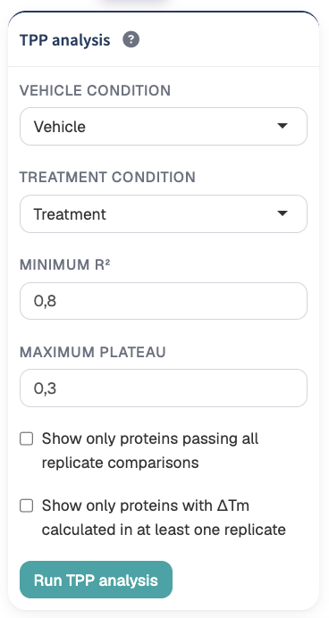
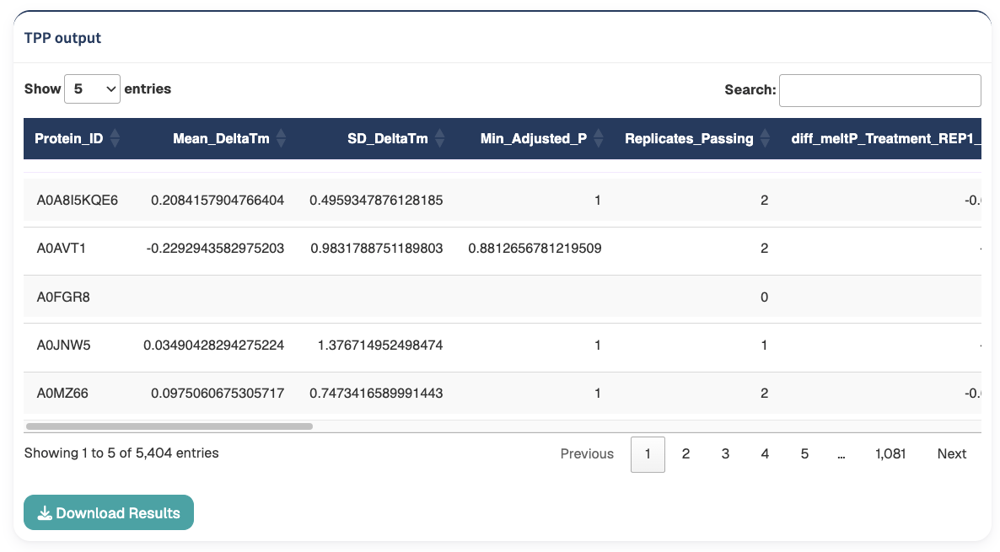
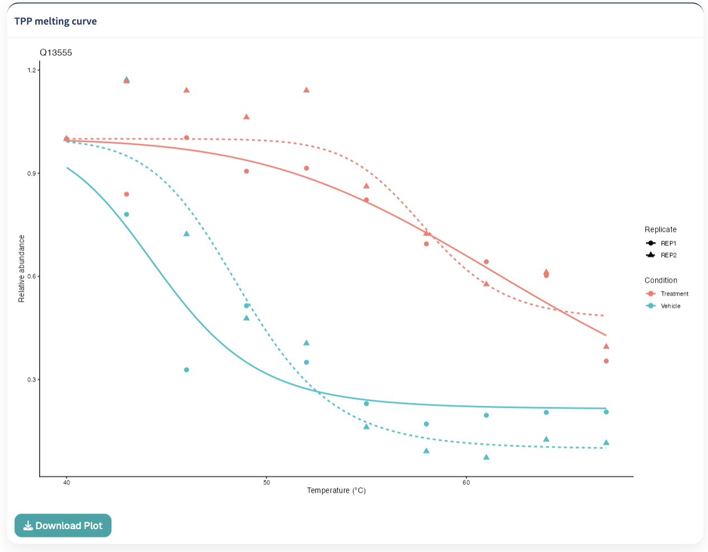
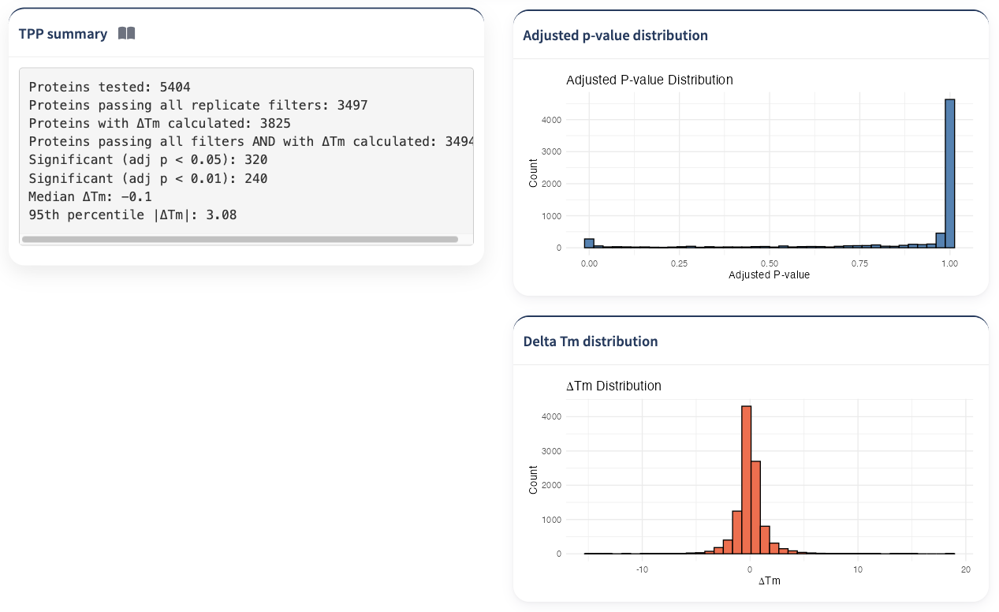
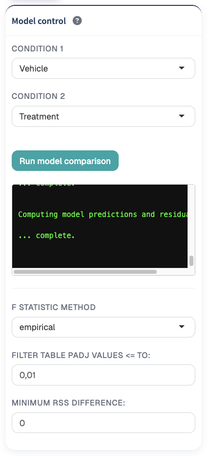
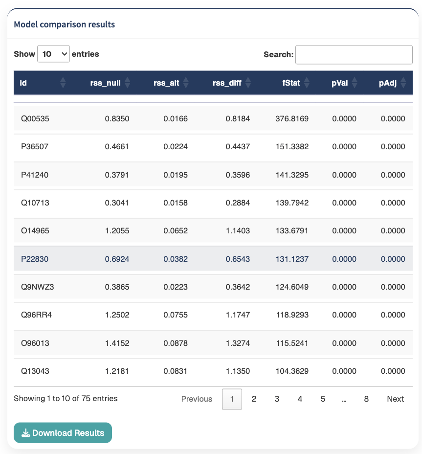
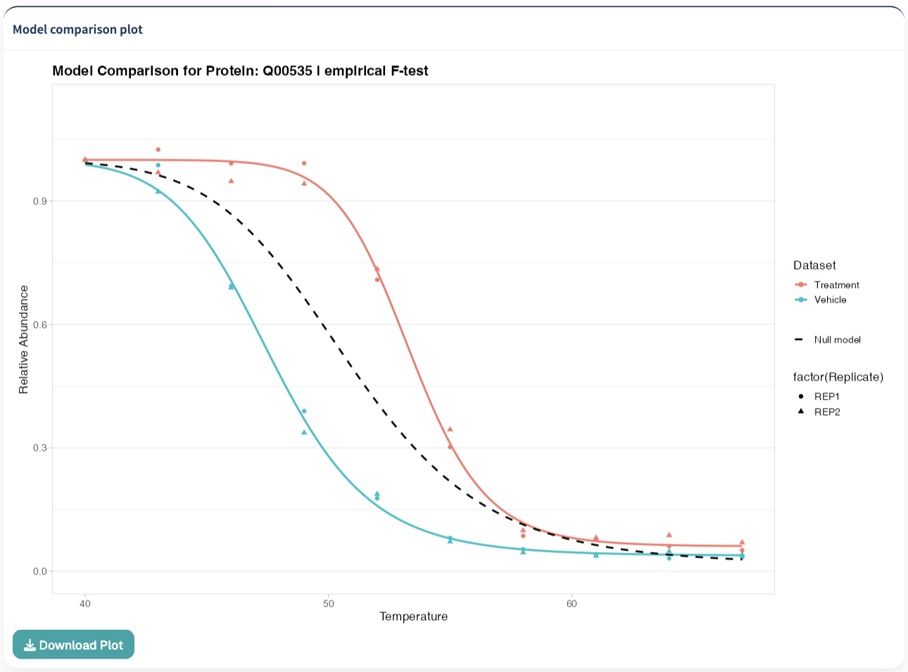
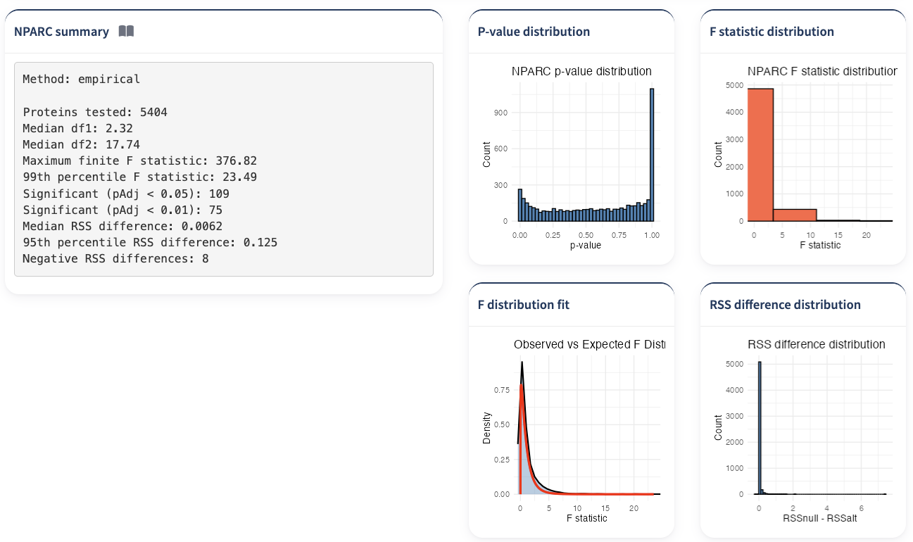

The Comparison Models section provides statistical approaches for identifying proteins whose thermal stability differs between experimental conditions.

TPP Analyst provides two complementary comparison methods:

1. **TPP analysis**, which evaluates differences in estimated protein melting temperatures (ΔTm) between conditions.
2. **NPARC**, which compares complete protein thermal response curves between conditions.

The TPP approach is centered on melting-temperature shifts, whereas NPARC evaluates differences across the complete thermal profile and can therefore identify changes that are not necessarily characterized by a large shift in Tm.

# Analysis requirements

Both comparison approaches operate on two selected experimental conditions.

Before running either analysis:

1. **Quality Control must have been completed for both conditions.**
2. The datasets must be normalized to the lowest temperature, or the application must be informed that the uploaded data were already normalized to the lowest temperature.
3. At least two conditions must be available for comparison.

::: {.callout-important}
## Quality Control is required

TPP and NPARC cannot be run until Quality Control has been applied to both selected conditions.
:::

::: {.callout-important}
## Lowest-temperature normalization

Both TPP and NPARC require thermal profiles normalized relative to the lowest temperature.

This requirement can be satisfied either by applying **Normalize to lowest temperature** in the [Normalization](normalization.qmd) module or by indicating that the input dataset had already been normalized to its lowest-temperature reference.
:::

# TPP analysis

The **TPP analysis** workflow compares protein melting temperatures between two experimental conditions.

The analysis follows a Tm-centric approach in which melting curves are fitted independently to the corresponding replicate profiles and the resulting melting temperatures are compared between conditions.

This provides an estimate of:

```text
ΔTm
```

representing the change in protein melting temperature between the selected conditions.

## Selecting conditions

Select the two datasets to compare using:

- **Vehicle condition**
- **Treatment condition**

Although these controls are labelled Vehicle and Treatment, they represent the two experimental datasets that will be compared.

{#fig-experimental-design width=85%}

The selected datasets should correspond to biologically meaningful comparison groups.

For example:

```text
Vehicle
Treatment
```

or:

```text
Control
Drug
```

## Replicate comparisons

TPP Analyst identifies the replicate structure of the selected datasets and creates corresponding comparisons between the two conditions.

For example:

```text
Vehicle replicate 1
        vs
Treatment replicate 1

Vehicle replicate 2
        vs
Treatment replicate 2
```

Melting curves are fitted for each protein within these replicate comparisons.

The resulting Tm differences and statistical results are subsequently combined in the TPP output.

::: {.callout-note}
## Replicate structure

TPP comparison assumes corresponding replicate structures between the two selected datasets.

Review the experimental design before running the analysis to ensure that the replicate assignments accurately represent the intended comparison.
:::

# TPP curve-quality filters

Two principal quality filters are applied during TPP analysis:

- **Minimum R²**
- **Maximum Plateau**

These determine which fitted curves are considered acceptable when calculating the statistical comparison.

## Minimum R²

The:

**Minimum R²**

control defines the minimum accepted curve-fit quality.

The default value is:

```text
0.8
```

Increasing the threshold applies a more stringent curve-quality criterion.

Proteins with fitted curves below the selected R² threshold do not pass the corresponding replicate filter.

## Maximum Plateau

The:

**Maximum Plateau**

control specifies the highest accepted fitted plateau value.

The default value is:

```text
0.3
```

Proteins whose fitted curves exceed this plateau threshold do not pass the corresponding replicate quality filter.

::: {.callout-tip}
## Curve-quality filtering

R² and plateau thresholds should be chosen to retain reliable thermal profiles while avoiding overly stringent filtering that removes large portions of the dataset.

Use the result summary and individual protein curves to assess the effect of the selected thresholds.
:::

## Running TPP analysis

After selecting the two conditions and setting the quality thresholds, click:

**Run TPP analysis**

TPP Analyst then:

1. prepares the selected condition datasets;
2. identifies the replicate structure and temperature points;
3. fits protein melting curves;
4. applies the selected R² and plateau quality filters;
5. calculates replicate-wise melting-temperature differences;
6. performs the statistical analysis;
7. generates the TPP result table and summary statistics.

# TPP results table

The **TPP output** table summarizes thermal stability changes for the tested proteins.

{#fig-experimental-design width=85%}

The table includes summary statistics together with replicate-specific results.

Important summary columns include:

```text
Protein_ID
Mean_DeltaTm
SD_DeltaTm
Min_Adjusted_P
Replicates_Passing
```

The table also retains replicate-specific:

- ΔTm values;
- adjusted p-values;
- pass/fail information from the curve-quality filters.

## Mean ΔTm

**Mean_DeltaTm** represents the average melting-temperature difference across the available replicate comparisons for a protein.

A positive ΔTm indicates that the estimated melting temperature is higher in the treatment condition relative to the vehicle condition.

A negative ΔTm indicates that the estimated melting temperature is lower in the treatment condition.

::: {.callout-note}
## Interpreting ΔTm

ΔTm describes the direction and magnitude of the estimated thermal stability shift.

The statistical significance, replicate consistency, and curve quality should also be considered when interpreting an individual protein.
:::

## SD of ΔTm

**SD_DeltaTm** summarizes the variability of the ΔTm estimates across replicate comparisons.

Lower variability indicates greater agreement between replicate-specific thermal shifts.

## Minimum adjusted p-value

**Min_Adjusted_P** reports the smallest adjusted p-value observed across the available replicate comparisons for the protein.

## Replicates passing

**Replicates_Passing** reports how many replicate comparisons satisfy the selected TPP curve-quality criteria.

This provides a direct indication of the replicate support available for the reported protein result.

# Filtering the TPP results table

Two optional filters can be applied to the displayed TPP results.

## Show only proteins passing all replicate comparisons

Enable:

**Show only proteins passing all replicate comparisons**

to restrict the results to proteins that pass the selected curve-quality filters in every replicate comparison.

This provides a more stringent result set supported by all available replicate comparisons.

## Show only proteins with ΔTm calculated

Enable:

**Show only proteins with ΔTm calculated in at least one replicate**

to restrict the displayed table to proteins for which a finite ΔTm result is available in at least one replicate comparison.

::: {.callout-tip}
## Filtering TPP results

Use these options to move between a broad overview of the analysis and a more stringent set of proteins with stronger replicate and curve-quality support.
:::

# TPP melting curve plot

Select a protein from the TPP results table to display its replicate-specific thermal profiles.

{#fig-experimental-design width=85%}

The **TPP melting curve** visualization displays:

- observed thermal abundance measurements;
- fitted melting curves;
- experimental conditions;
- replicates.

Observed measurements are shown as points, while fitted curves are displayed as lines.

Color distinguishes the experimental conditions and line type or point shape distinguishes individual replicates.

The X-axis represents:

```text
Temperature (°C)
```

and the Y-axis represents:

```text
Relative abundance
```

::: {.callout-tip}
## Inspect individual TPP hits

For proteins of particular interest, inspect the individual melting curves together with the ΔTm values, adjusted p-values, and replicate filter results.

This helps determine whether a statistically prioritized protein also displays a convincing and reproducible thermal shift.
:::

# TPP summary

{#fig-experimental-design width=85%}

The **TPP summary** provides a global overview of the analysis.

The summary reports:

- **Proteins tested**
- **Proteins passing all replicate filters**
- **Proteins with ΔTm calculated**
- **Proteins passing all filters and with ΔTm calculated**
- **Significant proteins at adjusted p < 0.05**
- **Significant proteins at adjusted p < 0.01**
- **Median ΔTm**
- **95th percentile of |ΔTm|**

These values provide a rapid overview of the number of usable protein profiles, the statistical results, and the magnitude of thermal stability changes across the experiment.

## Adjusted p-value distribution

The **Adjusted p-value distribution** histogram displays the adjusted p-values generated across replicate comparisons.

This provides a global view of the statistical significance landscape of the TPP analysis.

An accumulation of small adjusted p-values indicates a larger number of proteins with statistical evidence for thermal stability differences.

## ΔTm distribution

The **Delta Tm distribution** histogram summarizes the melting-temperature differences observed across the replicate comparisons.

The distribution provides an overview of:

- the direction of thermal shifts;
- their overall magnitude;
- the presence of proteins with unusually large positive or negative ΔTm values.

::: {.callout-note}
## Global distributions

The adjusted p-value and ΔTm distributions are diagnostic summaries of the complete analysis.

Protein-level conclusions should be based on the individual statistical results together with replicate support and inspection of the corresponding melting curves.
:::


# NPARC

The **NPARC** workflow provides a complementary approach for detecting changes in protein thermal stability.

Instead of reducing each thermal profile primarily to a melting-temperature estimate, NPARC compares the complete thermal response between conditions.

For each protein, two models are considered:

- a **null model** representing a shared thermal response;
- an **alternative model** allowing separate thermal responses for the experimental conditions.

The analysis evaluates whether the condition-specific alternative model provides a sufficiently improved fit compared with the shared null model.

::: {.callout-tip}
## Why use NPARC?

NPARC can identify condition-dependent changes in the complete thermal response curve, including differences that may not be adequately summarized by a single Tm shift.

TPP and NPARC can therefore provide complementary evidence for changes in protein thermal stability.
:::

# Selecting conditions for NPARC

{#fig-experimental-design width=85%}

Select the two datasets to compare using:

- **Condition 1**
- **Condition 2**

At least two conditions must be available before the Model Comparison interface can be used.

After selecting the desired datasets, click:

**Run model comparison**

TPP Analyst prepares the selected datasets and fits the NPARC models.

# Protein inclusion in NPARC

Before model fitting, TPP Analyst removes missing quantitative observations.

Proteins are then retained only when they contain complete measurement coverage within the corresponding dataset according to the available experimental structure.

This ensures that model fitting is performed on proteins with sufficiently complete thermal profiles.

::: {.callout-note}
## Missing measurements

The set of proteins available for NPARC depends on the QC, filtering, and normalization decisions made earlier in the workflow.

If unexpectedly few proteins are available for model comparison, review the upstream data-processing steps.
:::

# NPARC model fitting

For each retained protein, TPP Analyst fits:

```text
Null model
```

representing the shared thermal profile, and:

```text
Alternative model
```

allowing condition-specific thermal profiles.

The goodness of fit of these models is then compared using an F statistic.

During model fitting, the application displays progress information in the console area of the Model control panel.

# F statistic method

TPP Analyst provides two approaches for estimating the NPARC F-test:

- **empirical**
- **theoretical**

Select the desired approach using:

**F statistic method**

The default selection is:

```text
empirical
```

Both empirical and theoretical test results are calculated when the model comparison is run, allowing the displayed results to be switched between the two methods without repeating the model-fitting step.

## Empirical method

The **empirical** option uses the empirical NPARC approach for determining the F-test statistics and corresponding significance estimates.

## Theoretical method

The **theoretical** option uses the theoretical F-distribution-based approach.

::: {.callout-tip}
## Comparing F-statistic methods

Because both methods are calculated during the same model-comparison run, the selector can be used to inspect how the resulting statistical evidence changes between the empirical and theoretical approaches.
:::

# Adjusted p-value filter

The:

**Filter table pAdj values <= to**

control specifies the maximum adjusted p-value displayed in the NPARC result table.

The default value is:

```text
0.01
```

Increasing the threshold displays a broader set of proteins.

Decreasing the threshold restricts the table to proteins with stronger statistical evidence.

If no proteins satisfy the selected threshold, TPP Analyst reports that no proteins pass the current filter.

# RSS difference

NPARC additionally reports the difference in residual sum of squares between the null and alternative models:

```text
RSS difference = RSSnull - RSSalt
```

A positive RSS difference indicates that the alternative condition-specific model reduces the residual error relative to the shared null model.

Only proteins with positive RSS differences are retained in the displayed results.

## Minimum RSS difference

The:

**Minimum RSS difference**

control allows the result table to be further restricted according to the magnitude of model-fit improvement.

The default value is:

```text
0
```

Increasing this threshold restricts the table to proteins showing progressively larger improvements when condition-specific models are fitted.

::: {.callout-tip}
## Combining statistical significance and model improvement

The adjusted p-value and RSS-difference filters provide complementary criteria.

The adjusted p-value reflects statistical evidence, while the RSS difference reflects the magnitude by which the alternative model improves the fit relative to the null model.
:::

# NPARC results table

The **Model comparison results** table displays proteins passing the current filtering thresholds.

{#fig-experimental-design width=85%}

The table contains:

```text
Protein identifier
rss_null
rss_alt
rss_diff
fStat
pVal
pAdj
```

Results are ordered from highest to lowest F statistic.

## rss_null

**rss_null** is the residual sum of squares obtained from the shared null model.

## rss_alt

**rss_alt** represents the residual sum of squares obtained from the condition-specific alternative model or models.

## rss_diff

**rss_diff** is calculated as:

```text
rss_null - rss_alt
```

Larger positive values indicate a greater reduction in residual error when separate condition-specific curves are used.

## F statistic

**fStat** describes the improvement in model fit relative to the additional flexibility introduced by the alternative model.

Larger F statistics indicate stronger evidence that the condition-specific model provides a better description of the protein thermal profiles.

## P-value

**pVal** reports the statistical significance associated with the F-test.

## Adjusted p-value

**pAdj** reports the p-value after correction for multiple testing.

This value is used by the adjusted p-value filter in the interface.

# Selecting a protein

Select one protein from the NPARC results table to display its model comparison.

Only one protein is selected at a time.

The selected protein is then shown in the:

**Model comparison plot**

# Model comparison plot

The NPARC model comparison plot displays the observed thermal profiles together with the fitted null and alternative models.

{#fig-experimental-design width=85%}

Observed measurements are displayed as points.

Experimental conditions are distinguished by color and replicates are distinguished using point shapes.

Condition-specific alternative curves are displayed using the corresponding condition colors.

The shared null model is displayed as a dashed black curve.

The plot title identifies:

- the selected protein;
- the currently selected F-test method.

The X-axis represents temperature and the Y-axis represents relative protein abundance.

::: {.callout-tip}
## Interpreting the model comparison plot

When the condition-specific alternative curves provide a substantially better representation of the observed measurements than the shared null curve, the protein may show evidence of condition-dependent thermal behavior.

Interpret the plot together with the F statistic, adjusted p-value, and RSS difference.
:::

# NPARC summary

{#fig-experimental-design width=85%}

The **NPARC summary** provides an overview of the complete model comparison.

The summary reports:

- selected F-test method;
- number of proteins tested;
- median df1;
- median df2;
- maximum finite F statistic;
- 99th percentile of the F statistic;
- number of proteins with adjusted p < 0.05;
- number of proteins with adjusted p < 0.01;
- median RSS difference;
- 95th percentile RSS difference;
- number of negative RSS differences.

These values provide a global overview of the statistical and model-fit characteristics of the analysis.

# NPARC diagnostic plots

Four diagnostic visualizations are provided:

1. **P-value distribution**
2. **F statistic distribution**
3. **Observed versus expected F distribution**
4. **RSS difference distribution**

These plots provide complementary information about the behavior of the model-comparison statistics across all tested proteins.

## P-value distribution

The **P-value distribution** histogram displays the unadjusted p-values produced by the selected NPARC F-test method.

This provides an overview of the statistical significance landscape across the tested proteins.

## F statistic distribution

The **F statistic distribution** displays the observed F statistics.

To prevent extreme F statistics from dominating the visualization, the displayed X-axis is restricted to the 99th percentile of the finite F-statistic distribution.

This makes the main body of the distribution easier to inspect.

## Observed versus expected F distribution

The **F distribution fit** compares the observed F-statistic density with the corresponding theoretical F distribution.

The observed distribution is displayed as a density curve, while the theoretical expectation is shown as a red line.

The theoretical curve is generated using representative degrees of freedom from the current results.

The plot title indicates whether the empirical or theoretical NPARC method is currently selected.

::: {.callout-tip}
## F-distribution diagnostic

Use this plot to inspect how the observed test statistics compare with the expected theoretical distribution.

This diagnostic can help identify deviations in the overall F-statistic distribution that may be relevant when interpreting the model-comparison results.
:::

## RSS difference distribution

The **RSS difference distribution** displays:

```text
RSSnull - RSSalt
```

across the tested proteins.

Positive values indicate that the condition-specific alternative model decreases residual error relative to the shared null model.

Proteins with larger positive RSS differences show greater improvements in fit under the alternative model.


# TPP and NPARC provide complementary analyses

The two comparison workflows evaluate thermal stability from different perspectives.

A simplified distinction is:

```text
TPP
↓
Fit melting curves for replicate profiles
↓
Estimate melting temperatures
↓
Compare Tm between conditions
↓
Evaluate ΔTm and statistical significance
```

whereas:

```text
NPARC
↓
Use complete thermal profiles
↓
Fit a shared null model
↓
Fit condition-specific alternative models
↓
Compare model fit
↓
Evaluate F statistics, p-values, and RSS differences
```

TPP therefore emphasizes **melting-temperature shifts**, while NPARC evaluates **differences across the complete thermal response curve**.

::: {.callout-tip}
## Using both approaches

A protein can display a clear ΔTm shift, a broader difference in curve shape, or both.

Using TPP and NPARC together can therefore provide complementary evidence when investigating condition-dependent changes in protein thermal stability.
:::

# Recommended TPP workflow

A typical TPP comparison is:

1. **Complete Quality Control for both conditions.**
2. **Ensure both datasets are normalized to the lowest temperature or marked as previously normalized.**
3. **Select the vehicle and treatment conditions.**
4. **Choose the minimum R² threshold.**
5. **Choose the maximum plateau threshold.**
6. **Click Run TPP analysis.**
7. **Review the TPP summary.**
8. **Inspect the ΔTm and adjusted p-value distributions.**
9. **Use the result filters to restrict the table when appropriate.**
10. **Review Mean ΔTm, adjusted p-values, and replicate support.**
11. **Select proteins of interest from the result table.**
12. **Inspect their individual replicate melting curves.**
13. **Download the result table and relevant plots.**

# Recommended NPARC workflow

A typical NPARC comparison is:

1. **Complete Quality Control for both conditions.**
2. **Ensure both datasets are normalized to the lowest temperature or marked as previously normalized.**
3. **Select Condition 1 and Condition 2.**
4. **Click Run model comparison.**
5. **Review the model-fitting progress information.**
6. **Select the empirical or theoretical F-statistic method.**
7. **Inspect the NPARC summary.**
8. **Review the p-value, F-statistic, observed-versus-expected F, and RSS-difference distributions.**
9. **Set an adjusted p-value threshold.**
10. **Set a minimum RSS-difference threshold when appropriate.**
11. **Review the filtered result table.**
12. **Select individual proteins of interest.**
13. **Compare their observed profiles with the null and condition-specific alternative curves.**
14. **Download the result table and relevant protein plots.**

::: {.callout-important}
## Statistical results should be interpreted together with the fitted profiles

A low adjusted p-value alone does not describe the biological nature of a thermal stability change.

For prioritized proteins, inspect the corresponding fitted curves, replicate consistency, ΔTm or RSS differences, and upstream QC results before drawing biological conclusions.
:::