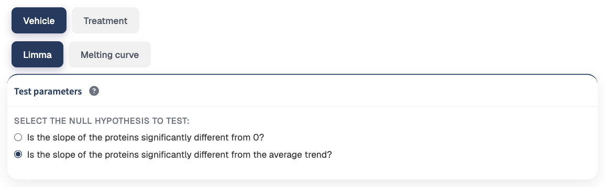
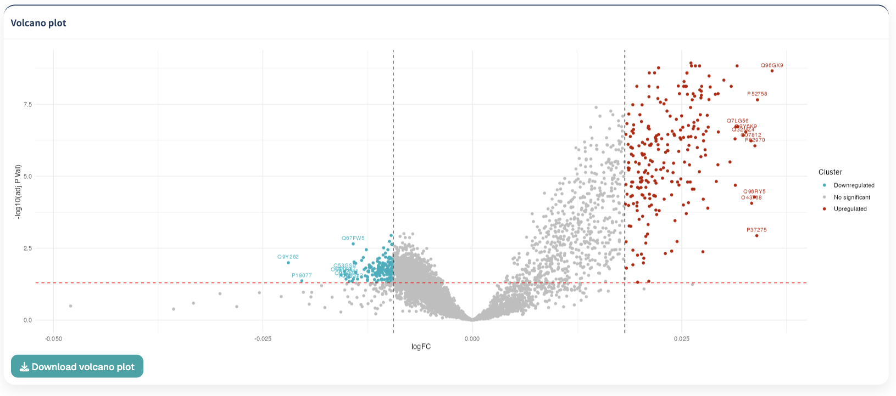
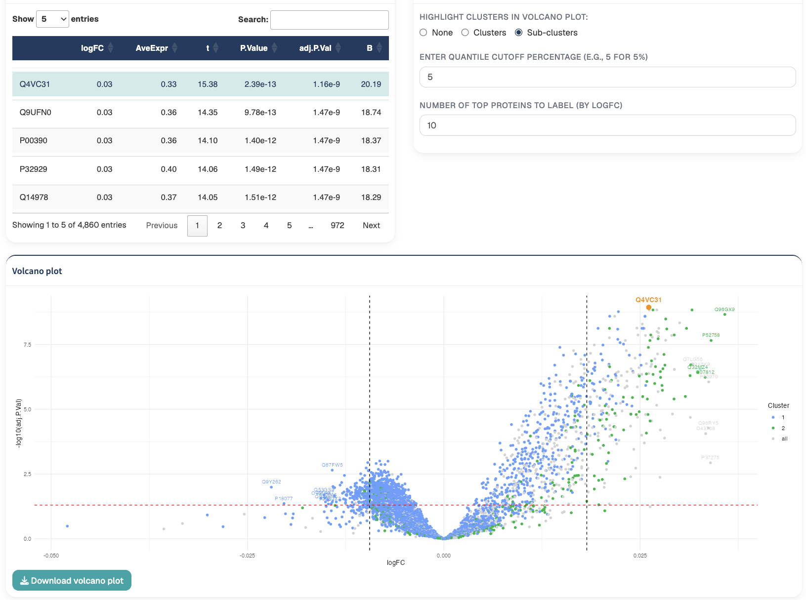
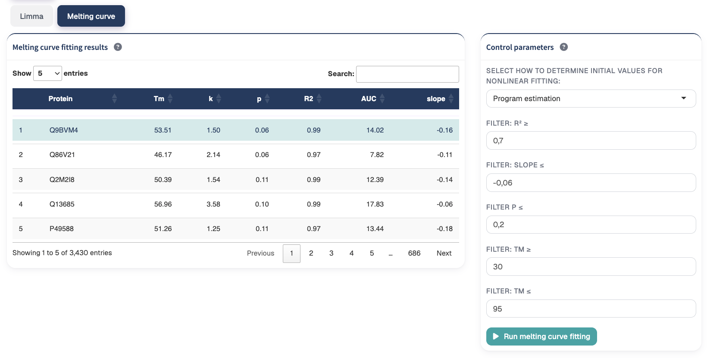
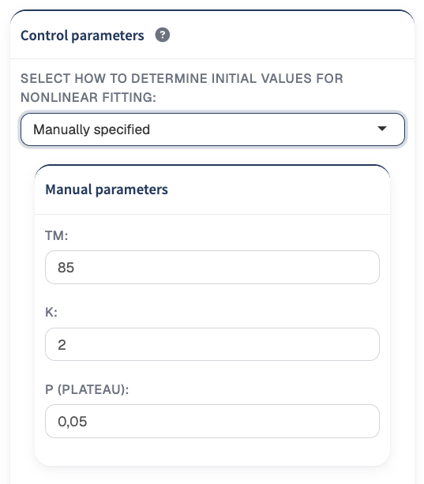
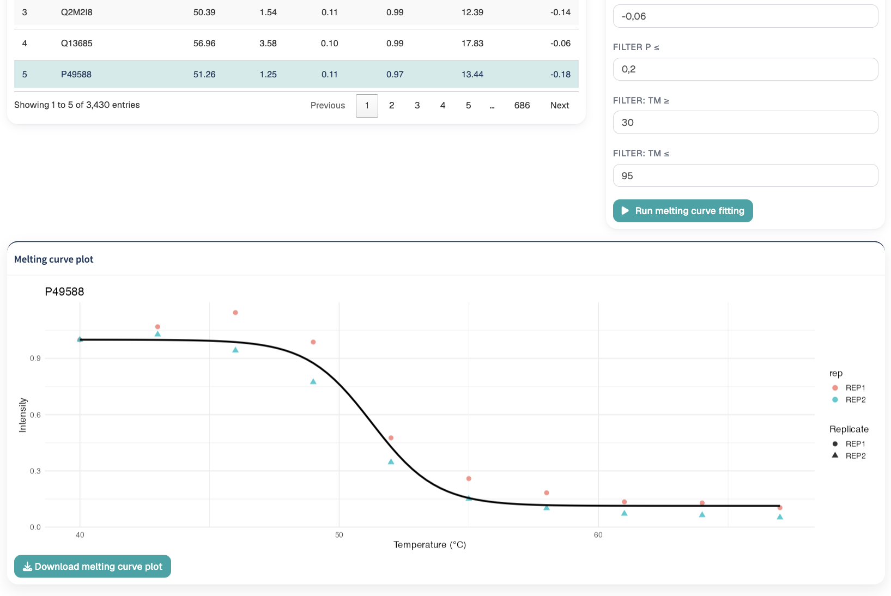
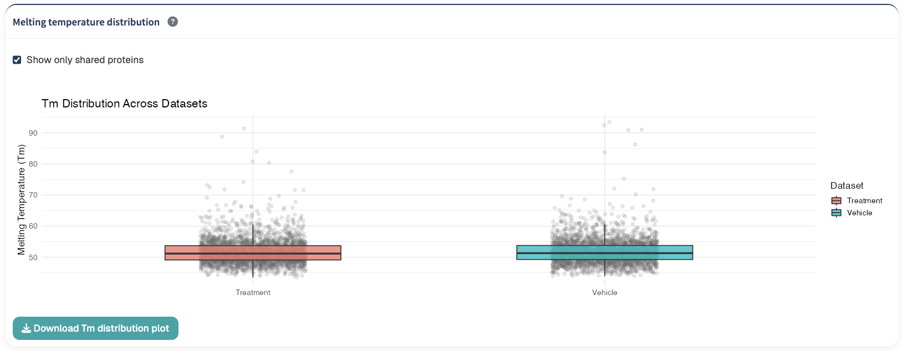

The Model Fitting module provides complementary approaches for investigating temperature-dependent protein abundance profiles.

Two analyses are available:

1. **Limma analysis**, which tests for significant temperature-dependent trends in protein abundance.
2. **Melting curve fitting**, which fits a sigmoidal thermal response model to individual protein profiles and estimates protein melting temperatures (Tm).

These approaches provide different perspectives on protein thermal behavior and can be used independently depending on the objectives of the analysis.

# Limma analysis

The **Limma** tab uses linear modeling to identify proteins whose abundance profiles change significantly across the temperature gradient.

Two different null hypotheses can be tested:

- whether the slope of an individual protein profile is significantly different from zero;
- whether the slope of an individual protein profile is significantly different from the average proteome trend.

## Selecting the null hypothesis

The **Select the Null hypothesis to test** control determines the type of thermal behavior evaluated by the analysis.

{#fig-experimental-design width=85%}

### Slope significantly different from zero

Select:

**Is the slope of the proteins significantly different from 0?**

to identify proteins whose abundance changes significantly with temperature.

Under this model, temperature is used to estimate the direction and magnitude of the abundance trend for each protein.

Proteins with statistically significant slopes display evidence of systematic changes in abundance across the thermal gradient.

### Slope significantly different from the average trend

Select:

**Is the slope of the proteins significantly different from the average trend?**

to identify proteins whose thermal behavior differs from the overall proteome-wide response.

Before statistical testing, the average abundance profile across proteins is calculated and removed from the individual protein measurements.

The analysis therefore focuses on proteins whose temperature-dependent behavior departs from the dominant trend of the dataset.

::: {.callout-tip}
## Choosing the hypothesis

Use **slope different from zero** when the objective is to identify proteins showing a significant temperature-dependent abundance change.

Use **slope different from the average trend** when the objective is to identify proteins whose thermal behavior is unusual relative to the overall proteome response.
:::

## Limma results

The **Limma results** table summarizes the statistical analysis for each protein.

The results include the estimated temperature-associated effect together with the corresponding statistical significance.

Adjusted p-values are calculated to account for multiple testing.


::: {.callout-note}
## Selecting proteins from the results table

Selecting proteins in the Limma results table highlights the corresponding proteins in the volcano plot.

This provides a convenient way to investigate proteins of interest directly from the statistical results.
:::

## Limma volcano plot

The volcano plot summarizes the magnitude and statistical significance of the temperature-associated effects.

{#fig-experimental-design width=85%}

The X-axis represents:

```text
logFC
```

and the Y-axis represents:

```text
-log10(adjusted p-value)
```

A horizontal dashed line indicates an adjusted p-value threshold of:

```text
0.05
```

Proteins with stronger statistical evidence appear higher on the plot.

The position along the X-axis represents the direction and magnitude of the estimated temperature-associated effect.

## Quantile cutoff

The **quantile cutoff percentage** determines the lower and upper logFC thresholds used to classify proteins in the volcano plot.

For example, with the default setting:

```text
5%
```

the lower threshold corresponds to the 5th percentile of the logFC distribution and the upper threshold corresponds to the 95th percentile.

Proteins are classified as:

- **Downregulated** when their logFC is below the lower cutoff and adjusted p-value is below 0.05;
- **Upregulated** when their logFC is above the upper cutoff and adjusted p-value is below 0.05;
- **No significant** otherwise.

The quantile cutoff can be adjusted between 0 and 50%.

::: {.callout-note}
## Quantile-based classification

The quantile cutoff controls the visual classification of proteins in the volcano plot.

The significance classification therefore depends on both the adjusted p-value and the position of the protein within the observed logFC distribution.
:::

## Protein labels

The **Number of top proteins to label (by logFC)** control determines how many proteins are automatically labelled at each extreme of the significant logFC distribution.

For example, the default value:

```text
10
```

labels up to 10 proteins with the highest significant logFC values and up to 10 proteins with the lowest significant logFC values.

This facilitates rapid identification of proteins showing the largest temperature-associated effects.

## Highlighting clusters in the volcano plot

If clustering has previously been performed, TPP Analyst can integrate the clustering results into the Limma volcano plot.

{#fig-experimental-design width=85%}


Three options may be available:

- **None**
- **Clusters**
- **Sub-clusters**

The available options depend on whether clustering or sub-clustering results have already been generated.

### None

With **None** selected, proteins are colored according to their volcano-plot classification:

- upregulated;
- downregulated;
- not significant.

### Clusters

Select **Clusters** to color proteins according to the cluster assignments generated in the Clustering module.

This allows statistical results from Limma to be interpreted in the context of the thermal-profile groups identified during clustering.

### Sub-clusters

Select **Sub-clusters** to highlight proteins according to their sub-cluster assignments.

Proteins that do not belong to the available sub-cluster result are displayed separately.

::: {.callout-tip}
## Integrating clustering and Limma

Cluster highlighting can help determine whether proteins displaying significant temperature-associated effects are concentrated within particular thermal-profile clusters identified during exploratory analysis.
:::

## Highlighting selected proteins

Proteins manually selected in the Limma results table are emphasized in the volcano plot.

Selected proteins are shown as larger orange points and are labelled using their protein accession.

This highlighting is independent of the general volcano-plot color scheme and can therefore be used together with cluster or significance coloring.


# Melting curve fitting

The **Melting curve** tab fits a sigmoidal thermal response model independently to each protein.

{#fig-experimental-design width=85%}

The fitted curve is used to estimate several characteristics of the thermal profile, including:

- **Melting temperature (Tm)**
- **k**
- **Plateau (p)**
- **R²**
- **Area under the curve (AUC)**
- **Slope**

These parameters can be used to evaluate both the thermal behavior of individual proteins and the quality of their fitted melting curves.

## Requirement: normalization to the lowest temperature

Melting curve fitting requires the datasets to be normalized to their lowest-temperature measurements.

Before running the analysis, ensure that:

**Normalize to lowest temperature**

has been applied in the Normalization module.

For analyses involving multiple datasets, lowest-temperature normalization must have been applied to all datasets.

::: {.callout-important}
## Lowest-temperature normalization is required

TPP Analyst does not run the melting curve analysis if the datasets have not been normalized to the lowest temperature.

:::

## Complete protein profiles

Melting curves are fitted using proteins with complete quantitative profiles.

Proteins containing missing measurements in the input used for curve fitting are excluded before model fitting.

::: {.callout-note}
## Missing measurements

The availability of proteins for melting curve fitting depends on the QC and normalization decisions made in previous sections.

Review missing-value handling and filtering before fitting the curves if a large number of proteins are unavailable.
:::

## Sigmoidal melting model

TPP Analyst fits a sigmoidal curve that describes the change in relative protein abundance across the temperature gradient.

The fitted parameters characterize different aspects of the thermal profile.

### Melting temperature (Tm)

The **melting temperature (Tm)** represents the estimated midpoint of the fitted thermal transition.

Tm is one of the principal parameters used in classical thermal proteome profiling analysis.

### k

The **k** parameter controls the shape and steepness of the fitted transition.

It contributes to the calculation of the curve slope.

### Plateau (p)

The **plateau (p)** parameter represents the lower asymptotic abundance of the fitted melting curve.

### R²

**R²** describes how closely the fitted sigmoidal curve represents the observed protein measurements.

Higher R² values indicate closer agreement between the fitted model and the observed thermal profile.

### Slope

The **slope** provides a measure of the steepness of the fitted melting transition.

### Area under the curve

The **AUC** summarizes the observed protein abundance across the measured temperature range.

## Initial values for nonlinear fitting

Nonlinear model fitting requires initial estimates for the model parameters.

TPP Analyst provides two approaches:

- **Program estimation**
- **Manually specified**

## Program estimation

**Program estimation** automatically determines starting values from each protein profile.

The initial estimates are based on the measured abundance values and are used as starting points for nonlinear optimization.

The program-estimated starting values include:

- Tm estimated from the temperature associated with an abundance close to the median profile value;
- k initialized according to the variability of the abundance measurements;
- plateau initialized from the minimum observed abundance.

::: {.callout-note}
## Starting values are not final fitted values

The automatically estimated values are used only to initialize nonlinear curve fitting. The final Tm, k, and plateau values are determined by the fitted model.
:::

## Manually specified starting values

Select:

**Manually specified**

to provide custom initial values for:

- **Tm**
- **k**
- **p (plateau)**

{#fig-experimental-design width=60%}

These values are used as starting guesses for the nonlinear fit.

They do not constrain the final fitted parameters to the manually supplied values.

::: {.callout-tip}
## Manual starting values

Manual initialization can be useful when automatic starting values do not provide satisfactory convergence for a dataset with unusual thermal profiles.

For most datasets, program estimation provides a convenient starting point.
:::

## Running melting curve fitting

After configuring the starting-value method and quality filters, click:

**Run melting curve fitting**

TPP Analyst fits the sigmoidal model to the protein profiles and calculates the corresponding fitting parameters.

The fitting process is performed independently for each protein.

## Curve quality filters

After curve fitting, proteins are filtered using five user-defined criteria:

- **R²**
- **Slope**
- **Plateau**
- **Minimum Tm**
- **Maximum Tm**

Only proteins satisfying all selected criteria are retained in the melting curve results table and downstream Tm summaries.

## R² threshold

The:

**Filter: R² ≥**

control defines the minimum fit quality accepted by TPP Analyst.

The default value is:

```text
0.7
```

Only proteins with an R² value equal to or greater than this threshold are retained.

Increasing the threshold applies a more stringent curve-quality requirement.

## Slope threshold

The:

**Filter: slope ≤**

control defines the maximum accepted fitted slope.

The default value is:

```text
-0.06
```

Only proteins satisfying the selected slope threshold are retained.

## Plateau threshold

The:

**Filter p ≤**

control limits the maximum accepted plateau value.

The default value is:

```text
0.2
```

Proteins with fitted plateau values above the selected threshold are excluded from the displayed results.

## Tm range

The estimated melting temperature can be restricted using:

**Filter: Tm ≥**

and:

**Filter: Tm ≤**

The default range is:

```text
30°C to 95°C
```

Only fitted proteins with Tm estimates inside the selected interval are retained.

::: {.callout-tip}
## Quality filters

R², slope, plateau, and Tm filters should be considered together.

These filters allow poorly fitted or biologically implausible thermal profiles to be excluded before Tm estimates are used in downstream comparisons.
:::

## Updating curve filters

Curve-fitting filters are interactive.

After the filtering controls are changed, TPP Analyst updates the accepted protein set without requiring all melting curves to be fitted again.

A short delay is applied after changing filter settings before the displayed results are updated.

::: {.callout-note}
## Fitting versus filtering

**Run melting curve fitting** performs the computationally intensive curve-fitting step.

Changing the R², slope, plateau, or Tm thresholds subsequently changes which fitted proteins are retained without requiring the original nonlinear fitting procedure to be repeated.
:::


## Selecting an individual protein

Select a protein directly from the melting curve results table to display its thermal profile.

Only one protein is selected at a time.

The selected protein is displayed in the **Melting curve plot**.

{#fig-experimental-design width=85%}

## Melting curve plot

The melting curve plot displays the experimental measurements for the selected protein together with its fitted sigmoidal curve.

Individual replicate measurements are distinguished using different point shapes and colors.

The X-axis represents:

```text
Temperature (°C)
```

and the Y-axis represents protein:

```text
Intensity
```

The fitted sigmoidal curve provides a visual representation of how well the model describes the measured thermal profile.

::: {.callout-tip}
## Inspect individual fits

Summary parameters such as R² are useful for automated filtering, but individual melting curves should also be visually inspected when evaluating proteins of particular biological interest.
:::

## Melting temperature distribution

The **Melting temperature distribution** plot compares the accepted Tm estimates across the available datasets.

{#fig-experimental-design width=85%}

For each dataset, individual protein Tm values are displayed together with a boxplot summarizing their distribution.

Only proteins whose fitted curves satisfy the currently selected R², slope, plateau, and Tm filters contribute to the distribution.

This visualization provides a global overview of protein thermal stability across the analyzed datasets.

## Shared proteins

Enable:

**Show only shared proteins**

to restrict the Tm distribution to proteins with accepted curve fits shared across the relevant datasets.

This provides a more directly comparable set of protein Tm estimates when examining multiple experimental conditions.

::: {.callout-note}
## Quality filters and shared proteins

A protein must first pass the current melting-curve quality criteria to be included in the Tm distribution.

The shared-protein option further restricts the visualization to proteins represented across the compared datasets.
:::

## Interpreting Tm distributions

Differences in the overall Tm distributions can provide an overview of thermal stability across datasets.

However, global Tm distributions do not by themselves identify statistically significant protein-specific thermal stability changes.

Protein-level comparisons between experimental conditions are performed in the downstream comparison analyses.


## Recommended Limma workflow

A typical Limma analysis is:

1. **Select the desired null hypothesis.**
2. **Review the Limma results table.**
3. **Inspect the adjusted p-values and estimated effects.**
4. **Set the desired quantile cutoff for volcano-plot classification.**
5. **Choose how many proteins should be labelled.**
6. **Highlight clusters or sub-clusters when previous clustering results are available.**
7. **Select proteins of interest directly from the results table when needed.**
8. **Inspect the corresponding highlighted proteins in the volcano plot.**
9. **Download the volcano plot when required.**

## Recommended melting curve workflow

A typical melting curve fitting workflow is:

1. **Ensure all relevant datasets have been normalized to the lowest temperature.**
2. **Select program-estimated or manually specified starting values.**
3. **Choose the initial R², slope, plateau, and Tm filtering criteria.**
4. **Click Run melting curve fitting.**
5. **Review the number of proteins passing the selected quality filters.**
6. **Inspect the fitted parameter values in the results table.**
7. **Adjust the quality filters if necessary.**
8. **Select proteins of interest and inspect their individual fitted curves.**
9. **Inspect the Tm distribution across datasets.**
10. **Enable shared proteins when a directly comparable protein set is required.**
11. **Download relevant plots for reporting or further interpretation.**

::: {.callout-important}
## Model fitting and downstream analyses

The quality of fitted thermal profiles directly affects the interpretation of the estimated melting temperatures.

Use the available fit-quality parameters together with visual inspection of representative protein curves before interpreting Tm values or using fitted proteins in downstream comparisons.
:::

## Next step

After fitting and evaluating protein thermal profiles, continue to [Protein Plots](proteinplots.qmd) for detailed visualization of individual proteins.