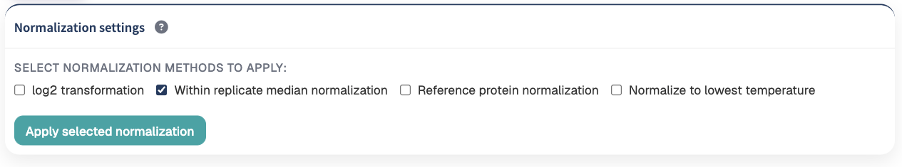
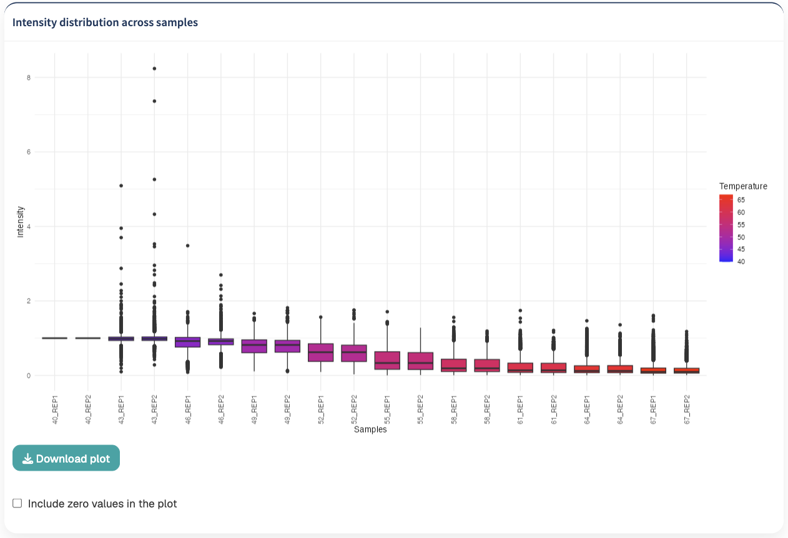
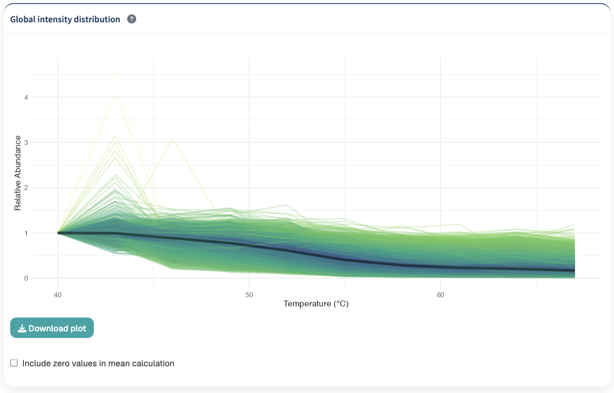
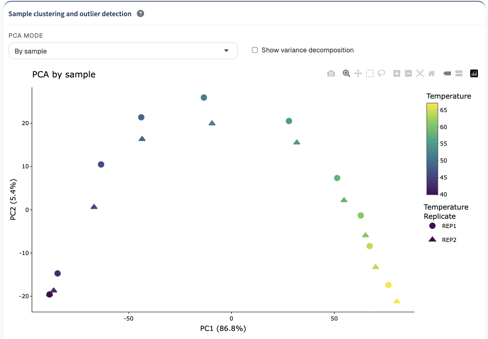
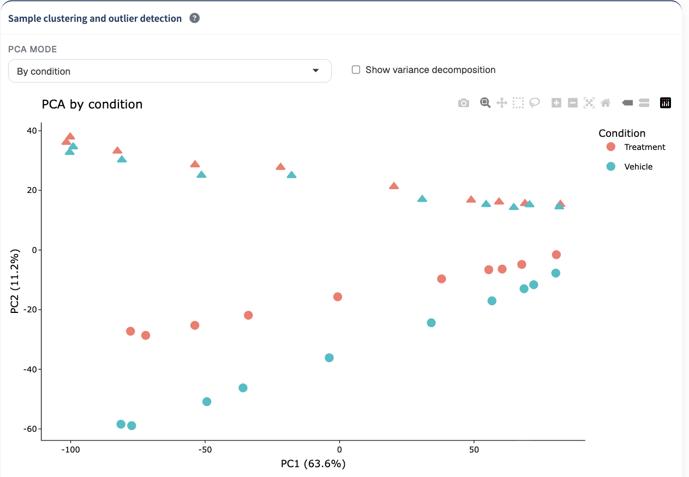
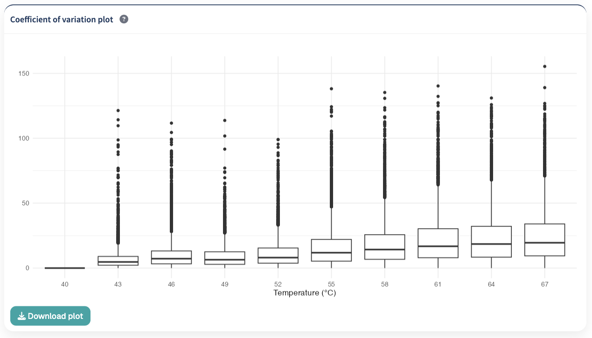

The Normalization module prepares the quality-controlled protein abundance data for downstream analysis.

TPP Analyst provides several normalization strategies that can be applied individually or in combination. The module also provides diagnostic visualizations for assessing sample distributions, global protein trends, sample similarity, potential outliers, and replicate variability.

The main steps of the normalization workflow are:

1. **Select one or more normalization methods**
2. **Apply the selected normalization**
3. **Inspect sample intensity distributions**
4. **Inspect global protein abundance trends**
5. **Assess sample similarity and potential outliers using PCA**
6. **Remove problematic samples if necessary**
7. **Reapply normalization after sample removal**
8. **Evaluate replicate variability using the coefficient of variation**

## Normalization settings

TPP Analyst provides four normalization options:

- **log2 transformation**
- **Within replicate median normalization**
- **Reference protein normalization**
- **Normalize to lowest temperature**

One or more methods can be selected before clicking **Apply selected normalization**.

{#fig-experimental-design width=85%}

If no normalization method is selected, the quality-controlled dataset is retained without additional normalization.

::: {.callout-important}
## Applying normalization

Selecting a normalization method does not immediately modify the dataset.

After selecting the desired methods, click **Apply selected normalization** to apply the transformations and update the dataset used by the downstream analysis modules.
:::

## log2 transformation

The **log2 transformation** converts quantitative intensity measurements to the log2 scale.

This transformation compresses the range of protein intensities and can reduce the influence of very large abundance measurements.

Non-finite values generated during transformation are replaced with zero.

::: {.callout-note}
## Zero values

Because `log2(0)` is not finite, zero-valued measurements remain represented as zero after the transformation rather than as negative infinity.
:::

## Within replicate median normalization

The **Within replicate median normalization** option adjusts measurements according to the median abundance observed for each temperature and replicate.

For each temperature, TPP Analyst calculates the overall median abundance across finite, non-zero measurements. The median for each replicate at the same temperature is then compared with this overall value.

The difference between the replicate-specific median and the overall median is used to adjust the corresponding measurements.

Zero values remain zero during this normalization.

This procedure can reduce systematic abundance differences between replicates while maintaining the temperature-dependent structure of the dataset.

## Normalize to lowest temperature

The **Normalize to lowest temperature** option expresses the thermal profile of each protein relative to its abundance at the lowest measured temperature.

Normalization is performed independently for each replicate.

For each protein and replicate:

1. The lowest experimental temperature is identified.
2. The abundance measured at that temperature is used as the reference value.
3. All temperature points within the same replicate are divided by this reference value.

Consequently, the lowest-temperature measurement becomes the reference point for each thermal profile.

For example, if a replicate contains measurements at:

```text
40°C
43°C
46°C
49°C
52°C
```

the abundance at `40°C` is used as the denominator for the measurements belonging to that replicate.

::: {.callout-important}
## Invalid reference measurements

If the lowest-temperature reference measurement for a protein is zero or missing, the corresponding normalized measurements for that replicate cannot be calculated and are returned as missing values.
:::

::: {.callout-tip}
## Thermal profile normalization

Normalization to the lowest temperature is particularly useful when the downstream analysis focuses on relative changes in protein abundance across the thermal gradient rather than differences in absolute protein abundance.
:::

## Reference protein normalization

The **Reference protein normalization** option expresses quantitative measurements relative to a selected reference protein.

Two approaches are available:

- **Manually select**
- **Program estimation**

### Manual reference protein selection

Select **Manually select** and enter the protein accession to use as the reference.

TPP Analyst searches for the specified accession in the current dataset.

For every quantitative measurement, protein abundances are divided by the corresponding abundance of the selected reference protein.

If the specified accession cannot be found, TPP Analyst reports that the reference protein is not present in the dataset.

::: {.callout-warning}
## Reference protein selection

The manually entered protein identifier must correspond to an accession present in the current dataset.
:::

### Automatic reference protein estimation

Select **Program estimation** to allow TPP Analyst to identify a reference protein automatically.

The application calculates the standard deviation of each protein profile across the quantitative measurements and selects the protein with the lowest standard deviation as the reference.

This selects the protein displaying the most stable quantitative profile according to this criterion.

### Reference protein information

After reference protein normalization has been applied, TPP Analyst displays the accession of the reference protein used.

When the corresponding organism annotation is available, the application can additionally display:

- the protein name;
- the gene name.

::: {.callout-note}
## Reference protein removal

The reference protein itself is removed from the normalized dataset after reference protein normalization has been applied.
:::

## Combining normalization methods

Multiple normalization methods can be selected simultaneously.

When multiple methods are selected, TPP Analyst applies the selected transformations sequentially.

According to the current workflow, selected methods are evaluated in the following order:

1. **log2 transformation**
2. **Within replicate median normalization**
3. **Normalize to lowest temperature**
4. **Reference protein normalization**

::: {.callout-important}
## Order of transformations

When combining normalization methods, the transformations are not independent. Each selected method operates on the dataset produced by the preceding normalization step.

The order of the selected transformations should therefore be considered when configuring the analysis.
:::

## Intensity distribution across samples

The **Intensity distribution across samples** plot provides a sample-level overview of the quantitative values after the current normalization settings have been applied.

Each boxplot represents one temperature-replicate combination.

Samples are shown along the X-axis, while the Y-axis represents the corresponding protein intensity or transformed intensity.

The sample boxes are colored according to temperature.

{#fig-experimental-design width=85%}

This plot can be used to inspect whether systematic differences remain between temperatures or replicates after normalization.

### Including zero values

By default, zero values are excluded from the intensity distribution plot.

Enable:

**Include zero values in the plot**

to include zero-valued measurements in the displayed distributions.

::: {.callout-tip}
## Evaluating normalization

Compare the distributions across samples after normalization. Large systematic differences between comparable samples may indicate that additional inspection of the data or normalization strategy is required.
:::

## Global intensity distribution

The **Global intensity distribution** plot compares individual protein thermal profiles with the overall average profile of the dataset.

Each colored line represents the mean thermal profile of an individual protein across replicates.

The thick black line represents the average abundance profile across all proteins.

### Distance from the global profile

For each protein, TPP Analyst calculates its distance from the global average thermal profile across the measured temperatures.

The distance is based on the squared differences between the individual protein profile and the global average profile.

Protein lines are visually weighted according to their similarity to the global profile.

Proteins that closely follow the overall thermal trend are visually emphasized, while proteins showing profiles that differ more strongly from the global trend are displayed less prominently.

{#fig-experimental-design width=85%}

This visualization can help distinguish the dominant thermal response of the dataset from proteins displaying atypical abundance profiles.

### Including zero values

By default, zero measurements are excluded when calculating the protein-level mean profiles used in this visualization.

Enable:

**Include zero values in mean calculation**

to include zero measurements when calculating the displayed protein trends.

::: {.callout-note}
## Zero-value handling

The zero-value controls for the intensity distribution boxplot and the global intensity distribution are independent.

Changing these display options does not itself alter the underlying normalized dataset.
:::

## Sample clustering and outlier detection

TPP Analyst uses Principal Component Analysis (PCA) to examine similarities between samples and identify measurements that may behave differently from the rest of the experiment.

Two PCA modes are available:

- **By sample**
- **By condition**

The percentage of variance explained by PC1 and PC2 is displayed directly in the corresponding axis labels.

## PCA by sample

The **By sample** mode performs PCA on the current dataset.

{#fig-experimental-design width=85%}

Each point represents a temperature-replicate sample.

Points are:

- colored according to temperature;
- associated with replicate information.

Hovering over a point displays the corresponding replicate and temperature.

The PCA can be used to assess whether samples with similar experimental characteristics occupy similar regions of the reduced-dimensional space and to identify potential sample-level outliers.

::: {.callout-tip}
## PCA interpretation

Samples positioned far from otherwise comparable samples may warrant further inspection. Potential outliers should be evaluated in the context of the experimental design and the other QC diagnostics before being removed.
:::

## PCA by condition

The **By condition** mode compares samples across multiple experimental datasets.

{#fig-experimental-design width=85%}

Each point represents a sample associated with an experimental condition, temperature, and replicate.

Points are colored according to condition.

This view can be used to investigate the relationships between experimental conditions and determine whether condition-associated structure contributes to the major sources of variation in the dataset.

::: {.callout-note}
## Multiple datasets required

The **By condition** PCA requires more than one dataset to perform the comparison.
:::

## Variance decomposition

Enable:

**Show variance decomposition**

to replace the standard PCA visualization with a summary of the sources of variance associated with the principal components.

For PCA by sample, the visualization separates the variance into:

- **Batch variance**, based on replicate;
- **Residual variance**.

For PCA by condition, the visualization separates variance into:

- **Batch variance**, based on replicate;
- **Condition variance**;
- **Residual variance**.

The variance decomposition is shown for up to the first 10 principal components.

This visualization can help determine whether major components of variation are associated with replicate structure, experimental condition, or other unexplained variation.

## Selecting samples from the PCA

The PCA visualization is interactive.

Click a sample directly in the PCA plot to add it to the **Samples to remove** table.

Selected samples remain in this table until they are removed or the selection is changed.

Click:

**Remove selected**

to exclude selected samples from the working dataset.

Removed samples are displayed in the **Removed samples** table.

::: {.callout-warning}
## Removing samples

Removing a sample changes the quantitative dataset used for normalization and downstream analyses.

Sample removal should therefore be based on the experimental design and supporting evidence rather than PCA position alone.
:::

## Restoring removed samples

Samples that have been removed are retained in the **Removed samples** table.

Select the desired sample and click:

**Restore selected**

to return the sample to the analysis.

This allows sample removal decisions to be reversed without restarting the complete analysis workflow.

## Reapplying normalization after removing or restoring samples

Whenever samples are removed or restored, the previously calculated normalization is no longer considered current.

TPP Analyst displays a warning:

```text
Samples were removed or restored in the PCA section.
Please click 'Apply selected normalization' again to recompute all normalization steps.
```

After changing the sample set, click **Apply selected normalization** again.

This recalculates the normalization using the updated dataset.

::: {.callout-important}
## Reapply normalization after changing samples

Always click **Apply selected normalization** after removing or restoring samples.

This ensures that the normalization and downstream analyses are based on the current set of samples.
:::

## Coefficient of variation

The **Coefficient of variation plot** summarizes variability between replicates at each temperature.

{#fig-experimental-design width=85%}

For each protein and temperature, the coefficient of variation is calculated from the available replicate measurements.

Zero measurements are excluded from the CV calculation.

At least two non-zero replicate measurements are required for a protein to contribute a CV value at a particular temperature.

For data on the standard abundance scale, the coefficient of variation is calculated from the standard deviation relative to the mean abundance.

The resulting CV distributions are displayed as boxplots for each temperature.

### Interpreting CV values

Lower CV values indicate closer agreement between replicate measurements, while higher values indicate greater replicate-to-replicate variability.

Comparing distributions across temperatures can help identify regions of the thermal gradient associated with increased experimental variability.

::: {.callout-tip}
## Replicate consistency

Use the CV plot together with PCA and the sample intensity distributions. A sample or temperature displaying unusual behavior across several complementary diagnostics may warrant closer inspection.
:::


## Recommended normalization workflow

A typical normalization workflow in TPP Analyst is:

1. **Review the quality-controlled dataset.**
2. **Select the desired normalization method or combination of methods.**
3. **Configure the reference protein if reference normalization is selected.**
4. **Click Apply selected normalization.**
5. **Inspect the intensity distributions across samples.**
6. **Inspect the global intensity distribution.**
7. **Examine PCA by sample.**
8. **Inspect the variance decomposition when useful.**
9. **Use PCA by condition when comparing multiple datasets.**
10. **Inspect the coefficient of variation across temperatures.**
11. **Investigate potential problematic samples using the available diagnostics.**
12. **Remove a sample only when supported by the experimental context and QC evidence.**
13. **Reapply normalization if samples are removed or restored.**
14. **Reassess the diagnostic plots after normalization has been recalculated.**
15. **Proceed to clustering when the normalized dataset is satisfactory.**

::: {.callout-important}
## Normalized data are used downstream

The current normalized dataset is passed to subsequent TPP Analyst modules. Normalization settings and sample-removal decisions can therefore affect clustering, model fitting, protein-level visualization, and downstream statistical analyses.
:::

## Next step

Once normalization has been applied and the diagnostic visualizations have been reviewed, continue to [Clustering](clustering.qmd).