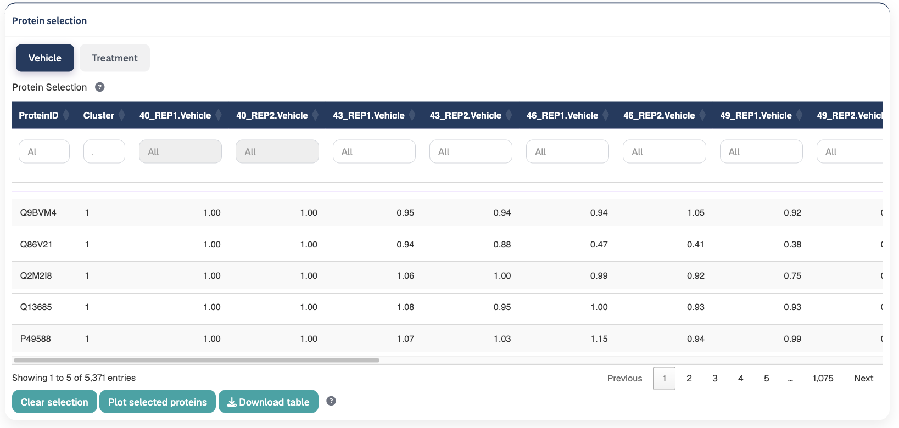
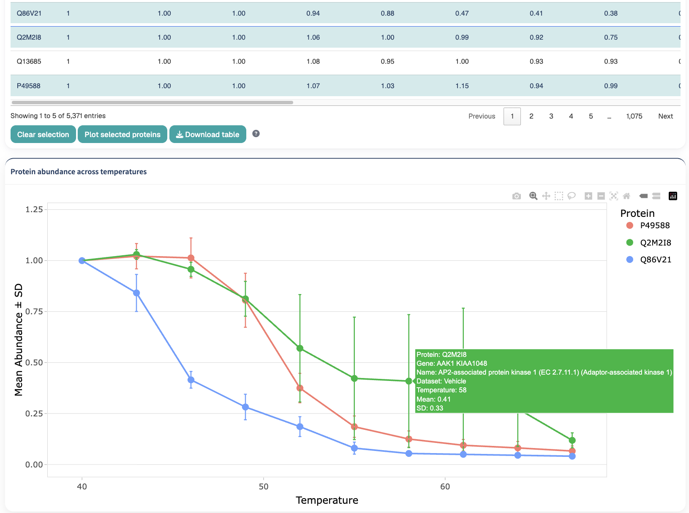
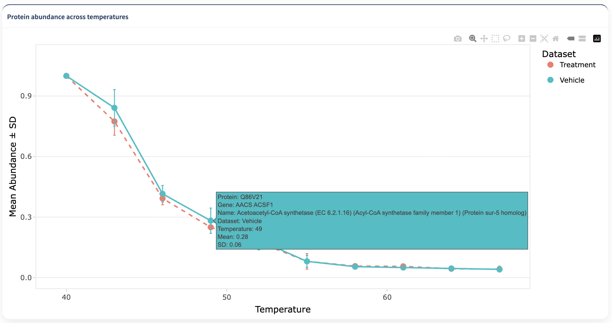

The Protein Plots section allows individual proteins to be selected for detailed visualization of their thermal abundance profiles.

Protein selection is performed independently for each dataset, allowing proteins from different experimental conditions to be selected and subsequently compared.

The main steps are:

1. **Select the dataset or condition of interest**
2. **Search or filter the protein table**
3. **Select one or more proteins**
4. **Click Plot selected proteins**
5. **Repeat the selection in additional conditions when required**
6. **Inspect the resulting protein thermal profiles**
7. **Download the protein table when needed**

## Protein selection

The **Protein Selection** table displays the proteins available in the currently active dataset.

{#fig-experimental-design width=85%}

Each row represents a protein.

The first column contains the protein identifier, while the remaining columns contain the quantitative measurements associated with the different temperatures and replicates.

When clustering information is available, the table also contains the cluster assigned to each protein.

::: {.callout-note}
## Data source

If clustering has not been performed, the Protein Selection table uses the current normalized dataset.

If clustering results are available, the corresponding cluster assignments are incorporated into the protein table.
:::

## Protein abundance measurements

The quantitative columns are organized according to:

1. **Temperature**
2. **Replicate**

For example, measurements may be displayed in an order such as:

```text
40_REP1
40_REP2
43_REP1
43_REP2
46_REP1
46_REP2
```

This arrangement facilitates comparison of replicate measurements at the same temperature.


::: {.callout-tip}
## Using cluster assignments

When clustering has already been performed, use the **Cluster** column to identify proteins belonging to a thermal-profile group of interest before generating individual protein plots.
:::

## Condition-specific protein tables

Protein selection is performed within the currently active condition or dataset.

Switching to another condition displays the protein table corresponding to that condition.

This allows proteins to be selected independently across experimental conditions.

::: {.callout-important}
## Selections are condition-specific

Protein selections in the Protein Plots workflow are associated with the active condition.

This makes it possible to select proteins from one condition, switch to another condition, and make additional selections for comparison.
:::

## Comparison clustering results

When the Clustering module has been used in **Condition comparison** mode, the clustering result can contain measurements from multiple datasets.

In the Protein Selection interface, TPP Analyst displays the measurements corresponding to the relevant active dataset while retaining the cluster assignment obtained from the comparison analysis.

This makes it possible to inspect a protein within an individual condition while retaining information about the cluster assigned from its combined multi-condition thermal profile.

## Searching and filtering the protein table

The Protein Selection table provides column-specific filters.

These filters can be used to restrict the displayed proteins according to identifiers, cluster assignments, or quantitative measurements.

### Filtering protein identifiers

Text columns can be searched using character matching.

This is particularly useful for locating specific protein accessions.

For example, entering a protein accession in the corresponding filter field restricts the displayed table to matching proteins.

### Filtering by cluster

When a **Cluster** column is present, the table can be filtered to proteins belonging to a particular cluster.

This provides a convenient way to inspect and select individual members of a thermal-profile group identified during clustering.

### Filtering quantitative measurements

Numeric columns can be filtered using numeric values or comparison operators.

Supported comparisons include:

```text
>value
>=value
<value
<=value
!=value
```

For example:

```text
>1
```

can be used to restrict a quantitative column to proteins with measurements greater than 1.

Similarly:

```text
<=0.5
```

restricts the table to proteins with measurements equal to or below 0.5 in the selected column.

::: {.callout-tip}
## Combining table filters

Filters can be applied to multiple columns to progressively narrow the table to proteins matching the desired characteristics.

For example, cluster membership can be combined with quantitative filters to identify proteins from a specific cluster that display particular abundance values.
:::

## Selecting proteins

One or more proteins can be selected directly from the table.

Click the desired rows to add them to the current selection.

Multiple rows can be selected simultaneously.

After selecting the proteins of interest, click:

**Plot selected proteins**

{#fig-experimental-design width=85%}

::: {.callout-tip}
## Selecting multiple proteins

Selecting several proteins at once is useful when comparing proteins displaying related thermal behaviors, proteins assigned to the same cluster, or a set of proteins of biological interest.
:::

## Plot selected proteins

The:

**Plot selected proteins**

button triggers visualization of the proteins currently selected from the active dataset.

Protein selections from different conditions can be combined through the broader Protein Plots workflow, allowing thermal abundance profiles to be compared across datasets.

{#fig-experimental-design width=85%}

The protein-selection table itself therefore serves as the interface between the processed datasets and the downstream protein-level visualization.

## Clearing the current selection

Click:

**Clear selection**

to remove the currently selected proteins from the active protein table.

This clears the selection without modifying the underlying protein dataset.

::: {.callout-note}
## Clear selection

**Clear selection** affects only the current protein selection.

The function does not remove proteins from the normalized dataset, clustering results, or any previous analysis step.
:::

## Switching between datasets

When the available data source changes, TPP Analyst updates the protein table to reflect the appropriate dataset.

For example, the table may use:

- the normalized protein dataset before clustering;
- the clustered dataset after clustering has been performed.

Selections that no longer correspond to the active data source are cleared automatically to prevent mismatched protein selections.

## Downloading the protein table

Click:

**Download table**

to export the protein table for the currently active condition as a CSV file.

The export corresponds to the condition currently displayed in the Protein Selection interface.


## Recommended protein-selection workflow

A typical Protein Plots workflow is:

1. **Select the experimental condition of interest.**
2. **Inspect the available protein table.**
3. **Use the accession filter to locate specific proteins when required.**
4. **Use the Cluster column when clustering information is available.**
5. **Apply quantitative filters if a specific abundance pattern is of interest.**
6. **Select one or more proteins from the table.**
7. **Click Plot selected proteins.**
8. **Switch to another condition when a cross-condition comparison is required.**
9. **Select additional proteins from that condition.**
10. **Generate the desired protein-level visualization.**
11. **Use Clear selection when the current active-condition selection should be reset.**
12. **Download the filtered protein table when required.**

::: {.callout-tip}
## Linking clustering and protein-level inspection

A useful workflow is to first identify interesting thermal-profile groups in the [Clustering](clustering.qmd) module and then use the **Cluster** column in Protein Plots to inspect individual proteins belonging to those groups.
:::

## Interpreting protein-level profiles

Protein-level visualization provides a more detailed view than global summaries or clustering averages.

Individual profiles can be useful for examining:

- replicate consistency;
- temperature-dependent abundance changes;
- differences between experimental conditions;
- profiles contributing to a particular cluster;
- unusual measurements that may not be apparent from dataset-level summaries.

Protein-level plots should be interpreted together with the quality-control, normalization, clustering, and model-fitting results.

::: {.callout-important}
## Protein plots are exploratory visualizations

Visual differences between protein profiles do not by themselves establish statistical significance.

Use the statistical analyses available in TPP Analyst when evaluating significant changes in thermal behavior between experimental conditions.
:::

## Next step

After inspecting individual protein profiles, continue to [GO Analysis](GO.qmd) for functional interpretation of selected protein groups.