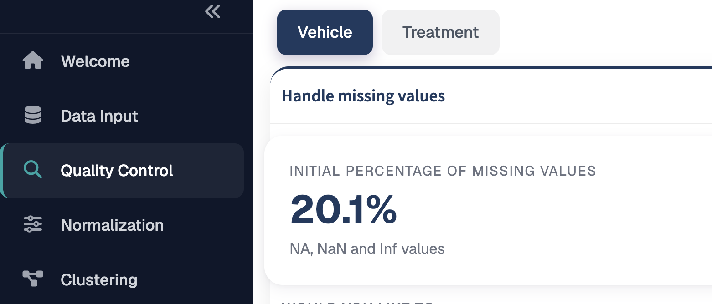
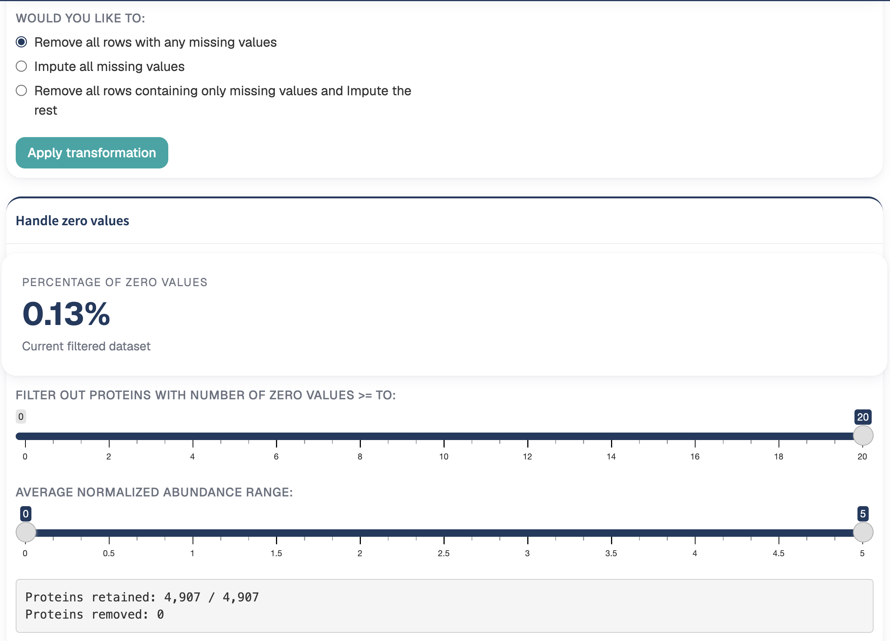
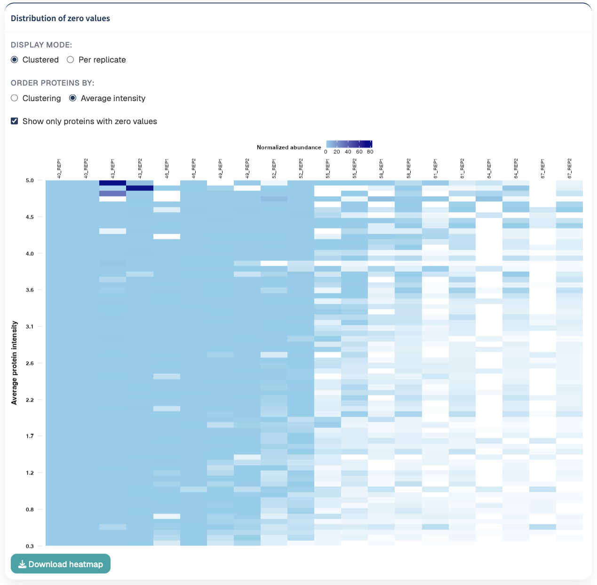
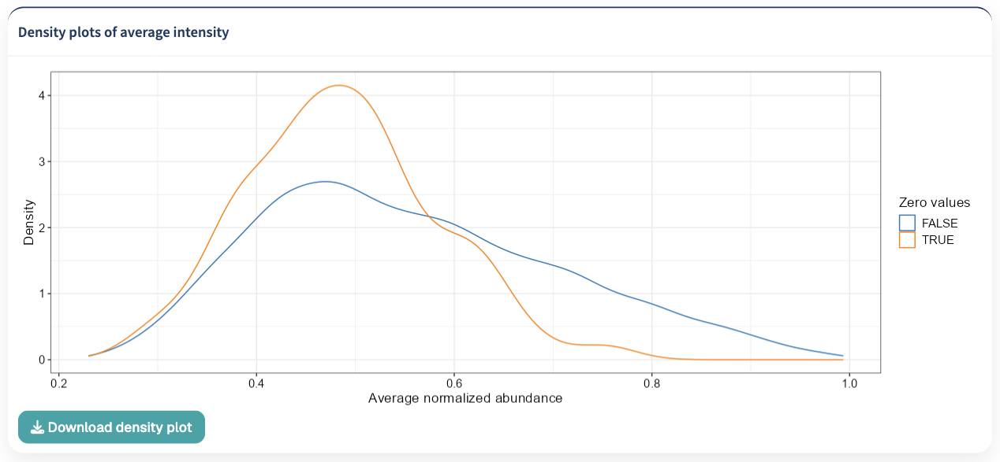
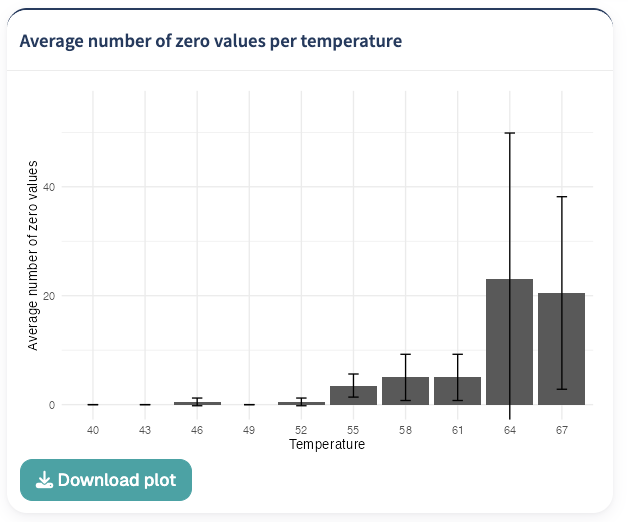
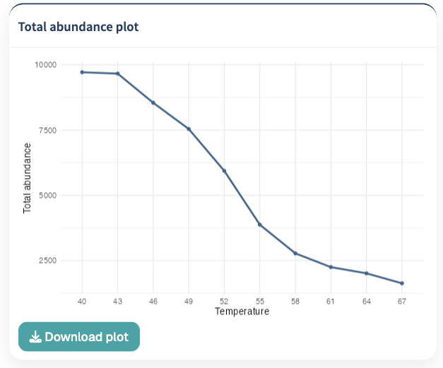

The Quality Control module provides tools for assessing, filtering, and preparing protein abundance data before normalization and downstream analysis.

Quality control is performed independently for each processed dataset. The module focuses on three main aspects of the data:

1. **Missing values**
2. **Zero values**
3. **Protein abundance distributions**

Filtering decisions made in this section determine which proteins are retained for subsequent analysis.

## Missing values

TPP Analyst reports the **initial percentage of missing values** before missing-value handling is applied.

The calculation considers the quantitative measurements and identifies the following values as missing:

- `NA`
- `NaN`
- `Inf`

The percentage shown at this stage represents the original level of missing data in the dataset.

{#fig-experimental-design width=85%}

## Handling missing values

TPP Analyst provides three strategies for handling missing values:

- **Remove all rows with any missing values**
- **Impute all missing values**
- **Remove all rows containing only missing values and impute the rest**

Select the desired strategy and then click **Apply transformation**.

::: {.callout-important}
## Apply the transformation

The selected missing-value strategy is not applied until **Apply transformation** is clicked.

The transformed dataset is then used by the subsequent quality-control steps.
:::

### Remove all rows with any missing values

The **Remove all rows with any missing values** option removes a protein if at least one quantitative measurement for that protein is missing.

This represents the most restrictive missing-value strategy because only proteins with complete quantitative profiles are retained.

::: {.callout-warning}
## Complete-case filtering

This option can remove a substantial number of proteins from datasets containing frequent missing measurements. Check the resulting number of retained proteins before continuing.
:::

### Impute all missing values

The **Impute all missing values** option retains proteins and replaces missing quantitative measurements using the selected imputation method.

TPP Analyst provides four imputation methods:

- **All to 0**
- **min**
- **knn**
- **MLE**

### Remove all rows containing only missing values and impute the rest

The **Remove all rows containing only missing values and impute the rest** option combines filtering and imputation.

Proteins containing no observed quantitative measurements are removed first.

Remaining proteins containing both observed and missing measurements are retained, and their missing values are estimated using the selected imputation method.

This option can be useful when completely unobserved proteins should be excluded while partially observed proteins should remain available for subsequent analysis.

## Imputation methods

When **Impute all missing values** or **Remove all rows containing only missing values and impute the rest** is selected, an imputation method must also be chosen.

### All to 0

The **All to 0** method replaces each missing quantitative measurement with zero.

This approach does not estimate a value from other proteins or measurements. Instead, missing observations are explicitly represented as zero.

Because zero values can subsequently be examined and filtered within the QC module, the effect of this transformation can be assessed using the zero-value visualizations and filters described below.

### Minimum-value imputation

The **min** method replaces missing measurements using the minimum observed value within the corresponding quantitative column.

This retains proteins containing missing measurements while assigning those observations a low abundance value based on the observed data.

### K-nearest neighbour imputation

The **knn** option performs K-nearest neighbour imputation.

TPP Analyst uses the available quantitative profiles to estimate missing measurements from similar proteins.

Proteins containing only missing quantitative values cannot contribute useful information to this procedure and are removed when necessary before KNN imputation is performed.

### Maximum-likelihood estimation

The **MLE** option uses maximum-likelihood-based imputation to estimate missing quantitative measurements.

Negative values produced during the imputation procedure are converted to zero before the transformed dataset is used downstream.

::: {.callout-warning}
## MLE and large datasets

MLE imputation is disabled when the quantitative dataset contains more than **3,000 proteins**.

For datasets above this threshold, select another imputation method.
:::

## Zero values

After missing-value handling has been applied, TPP Analyst evaluates zero values in the transformed dataset.

The **Percentage of Zero Values** indicator reports the percentage of quantitative measurements equal to zero in the current filtered dataset.

Unlike the initial missing-value percentage, this value can change when QC filters are adjusted.

::: {.callout-note}
## Missing values and zero values are treated separately

Missing-value handling is performed first. Zero values are subsequently evaluated and filtered using the transformed dataset.

For example, selecting **All to 0** during imputation converts missing observations into zero values, which can then be inspected and filtered in the zero-value QC section.
:::

## Filtering proteins by zero values

When zero values are present, TPP Analyst provides a slider for controlling how many zero measurements can be present in an individual protein profile.

The control is labelled:

**Filter out proteins with number of zero values >= to:**

Reducing the threshold progressively removes proteins containing larger numbers of zero measurements.

This provides a direct way to exclude sparsely quantified proteins before normalization and downstream analysis.

If the dataset contains no zero values, this filter is not displayed.

## Filtering proteins by average intensity

TPP Analyst also provides an average-intensity range filter.

The intensity for each protein is calculated using its positive quantitative measurements. Zero measurements are excluded when calculating the protein average.

The label of the filter depends on the preprocessing state of the dataset:

- **Average log2 intensity** for data that have not already been scaled;
- **Average intensity** for data already provided on a log2 scale;
- **Average normalized abundance** for data that have already been normalized.

Both the lower and upper limits can be adjusted.

Proteins with average values outside the selected range are removed from the current filtered dataset.

{#fig-experimental-design width=85%}

::: {.callout-tip}
## Intensity filtering

The intensity range can be used to exclude very low- or very high-abundance proteins when these proteins are not appropriate for the intended downstream analysis.

Adjust the range while inspecting the QC visualizations and the number of retained proteins.
:::

## Filter summary

Below the filtering controls, TPP Analyst reports:

- **Proteins retained**
- **Proteins removed**

The number of retained proteins is updated according to the current zero-value and intensity filters.

Use this information to assess how strongly the selected QC thresholds affect the size of the dataset.

::: {.callout-important}
## Check protein retention

Before proceeding to normalization, verify that the selected QC thresholds have not unintentionally removed a large proportion of the proteins required for the analysis.
:::

## Distribution of zero values

The **Distribution of zero values** heatmap provides an overview of protein abundance patterns and the distribution of zero measurements across the dataset.

Each row represents a protein and each column represents a quantitative measurement.

Abundance is represented using a color scale ranging from low to high protein intensity.

{#fig-experimental-design width=85%}

The display can be customized using several controls.

### Display mode

Two display modes are available:

- **Clustered**
- **Per replicate**

These options change how the quantitative columns are arranged in the heatmap.

**Clustered** organizes the measurements primarily according to temperature.

**Per replicate** organizes measurements primarily according to replicate and then temperature.

This allows the same dataset to be inspected from complementary perspectives.

### Protein ordering

Proteins can be ordered using:

- **Clustering**
- **Average intensity**

When **Clustering** is selected, proteins are ordered according to similarities in their abundance profiles.

When **Average intensity** is selected, proteins are ordered according to their average abundance, calculated from non-zero measurements.

The average-intensity view also displays an intensity reference alongside the heatmap.

### Show only proteins with zero values

The **Show only proteins with zero values** option restricts the heatmap to proteins containing at least one zero measurement.

This option is enabled by default and focuses the visualization specifically on proteins affected by zero values.

Disable the option to include proteins without zero measurements in the heatmap.

::: {.callout-tip}
## Inspecting zero-value patterns

The heatmap is particularly useful for determining whether zero values are distributed broadly across the experiment or concentrated in particular proteins, temperatures, or replicates.
:::

## Density plots of average intensity

The **Density plots of average intensity** visualization shows the distribution of protein abundance in the currently filtered dataset.

The abundance scale depends on the preprocessing state of the input data.

For unscaled datasets, abundance is displayed on a log2 scale. Data already marked as log2 transformed or normalized are displayed using their existing scale.

The density plot updates when the zero-value or average-intensity filters are changed.

This plot can help assess how the selected filtering thresholds affect the overall abundance distribution and is particullarly useful to compare the intensity distribution of proteins containing zero values with the distribution of proteins without zero values.

{#fig-experimental-design width=85%}

## Average number of zero values per temperature

The **Average number of zero values per temperature** plot summarizes the occurrence of zero values across the thermal gradient.

For each temperature, the plot displays the average number of zero measurements together with their variation.

This visualization can be used to identify temperatures at which zero measurements are more frequent.

Such patterns may be particularly relevant at higher temperatures, where protein abundance can decrease as thermal destabilization progresses.

{#fig-experimental-design width=85%}

## Total abundance plot

The **Total abundance plot** summarizes the total measured protein abundance at each temperature.

Quantitative measurements are combined by temperature, and the resulting total abundance is displayed across the thermal gradient.

This provides a dataset-level view of how the overall quantitative signal changes with temperature.

{#fig-experimental-design width=85%}

::: {.callout-note}
## Interpreting QC plots together

No single QC visualization should be considered in isolation.

The zero-value percentage, heatmap, intensity distribution, zero values per temperature, total abundance profile, and number of retained proteins provide complementary information about the effect of the selected QC settings.
:::

## Recommended QC workflow

A typical quality-control workflow in TPP Analyst is:

1. **Inspect the initial percentage of missing values.**
2. **Choose how missing values should be handled.**
3. **Select an imputation method when required.**
4. **Click Apply transformation.**
5. **Inspect the resulting percentage of zero values.**
6. **Examine the zero-value heatmap and density distribution.**
7. **Inspect zero values across temperatures and the total abundance profile.**
8. **Adjust the zero-value threshold if necessary.**
9. **Adjust the average-intensity range if necessary.**
10. **Check how many proteins are retained and removed.**
11. **Reassess the QC visualizations after filtering.**
12. **Proceed to normalization when the filtered dataset is satisfactory.**

::: {.callout-important}
## QC decisions affect downstream analysis

Proteins removed by the QC filters are excluded from subsequent processing. Review the retained protein count and QC visualizations before continuing.
:::

## Next step

Once missing values have been handled and the quality-control filters have been reviewed, continue to [Normalization](normalization.qmd).